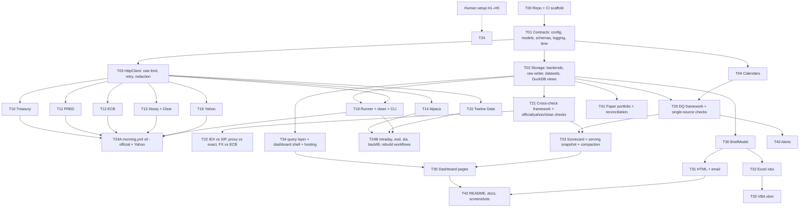

# Desk Brief — Implementation Plan

Status: v1, 2026-11-15. Source of truth for task order. Spec: `docs/specs/2026-11-15-desk-brief-design.md` (cited as **§n**). Process: `docs/process/agent-workflow.md`.

Rules that apply to every card:
- One card → one branch (`t{id}-{slug}`) → one PR. Target ≤ ~400 changed lines excluding fixtures/lockfile.
- A card may only touch files in its **Owns** list (+ its own tests and fixtures). Anything else → stop, ask the planner.
- `config.yaml` *values* are not contracts: a source card may add or adjust feeds/datasets **for its own source** (disclose in the PR). Other config edits go through the planner (ruling P-004 in `docs/plan/decisions.md`).
- **Contracts** (frozen after Phase 0): `models.py`, `schemas.py`, `sources/base.py`, `store/backend.py` public API, `config.py` models, storage key layout (§6), table schemas (§7.2), Excel table names (§9.2). Changing one needs a planner-approved `contract:` PR merged first.
- TDD: failing test first. No network in unit tests. Synthetic data only under `tests/`, labeled.
- Definition of done for every card: acceptance criteria met, `make ci` green locally and in CI, reviewer APPROVE, `docs/agent-log.md` entry appended.

---

## 1. Phase overview and dependency graph

### Parallel lanes (max concurrent implementers per window)

| Window | Lane A | Lane B | Lane C | Lane D | Lane E | Lane F |
|---|---|---|---|---|---|---|
| W0 Mon AM | T00 → T01 (sequential, single agent) | | | | | |
| W1 Mon PM | T02 | T03 | T04 | | | |
| W2 Tue | T19 | T10 → T13 | T11 → T12 | T14 | T15 | T16 |
| W3 Tue PM/Wed | T24A (**ship asap**) | T20 | T21 → T22 | T30 | T34 | |
| W4 Wed/Thu | T24B | T23 | T31 | T32 → T33 | T35 | T40 |
| W5 Fri | T41 | T42 | fixes from run history | | | |

Critical path: **T00 → T01 → T02/T03 → T19 + official sources → T24A** (scheduled runs start) → T20/T21 → T30 → T31 (email live). Everything else hangs off this.

### Timeline

| Date | Target |
|---|---|
| Mon 16 Nov | W0 + W1 merged. Human tasks H1–H5 done (accounts, keys, bucket, repo, branch protection) |
| Tue 17 Nov | W2 merged. T24A merged by evening → **first scheduled morning run Wed 18 11:15 UTC** (2 days earlier than brief) |
| Wed 18 Nov | T20, T21, T22, T30, T34 merged; T24B live (intraday + eod begin history) |
| Thu 19 Nov | T23, T31 (email live), T32, T35 merged |
| Fri 20 Nov | T33 (needs H6), T40, T41, T42. Screenshots |
| Sat–Sun 21–22 | Polish from run history; real incidents written up; user feedback (H8) |
| 23–28 Nov | Buffer; stretch (T50 narrative) only if all DoD met |

Cut order if behind: T41 → T40 → T33 → dashboard pages 5–6. Never cut: T24A, T20–T22, T31, scorecard.

---

## 2. Human tasks (Allen — cannot be done by agents)

| ID | Task | Needed by |
|---|---|---|
| H1 | Accounts + keys: Alpaca (paper account, data API keys), Twelve Data, FRED API key | T24A (Tue) |
| H2 | Cloudflare: create R2 bucket `deskbrief-data` (private); 3 API tokens: `ci-writer` (RW, this bucket), `dashboard-reader` (RO), `admin` | T02 integration, T24A |
| H3 | GitHub repo `desk-brief` (public). Branch protection on `main` per workflow doc §6 (single account, `review/approved` status gate). Secrets per spec §11 | T00 merge |
| H4 | healthchecks.io: two checks (morning, eod) with schedules; email alerts to you | T24A |
| H5 | Gmail app password (or Resend + domain), `REPORT_RECIPIENTS` secret | T31 |
| H6 | In desktop Excel: import `vba/*.bas` into blank `.xlsm`, add buttons, save; run `uv run python -m xlsxwriter.vba_extract` (or the `vba_extract.py` script) → commit `vbaProject.bin` | T33 |
| H7 | Streamlit Community Cloud: deploy `app/Home.py` as private app, add viewer emails, paste `dashboard-reader` secrets | T34 |
| H8 | Send dashboard + report to feedback users; capture feedback verbatim for README | Sat 21 |
| H9 | Verify provider display terms (Alpaca, Twelve Data, Yahoo) before hosted mode shows any T1/T2 market data; record outcome in `docs/terms.md` | T34 |

---

## 3. Task cards

Card format: **Depends** · **Parallel with** · **Owns** · **Spec** · Deliverables · Acceptance criteria · Out of scope.

### Phase 0 — Foundations (sequential)

#### T00 — Repo scaffold and strict CI
- **Depends:** none · **Parallel with:** none
- **Owns:** `pyproject.toml`, `uv.lock`, `Makefile`, `.github/workflows/ci.yml`, `.github/pull_request_template.md`, `.github/dependabot.yml`, `.gitleaks.toml`, `.gitignore`, `.env.example`, `README.md` (stub), `INCIDENTS.md` (template), `docs/agent-log.md`, `docs/glossary.md` (from brief §18), `src/deskbrief/__init__.py`, `tests/conftest.py`
- **Spec:** §13, §14, workflow doc §5–6
- Deliverables: uv project (Python 3.12); deps: pandas, duckdb, pyarrow, httpx, pydantic, pyyaml, structlog, pandera, tenacity, pandas-market-calendars, yfinance, xlsxwriter, jinja2, streamlit, python-ulid; dev: pytest, pytest-cov, pytest-socket, respx, ruff, mypy, pandas-stubs, types-PyYAML. `make ci` = `uv lock --check && ruff check && ruff format --check && mypy --strict src && pytest -m "not integration" --cov=deskbrief --cov-fail-under=85 && gitleaks`. CI jobs: `lint`, `typecheck`, `test`, `security` (gitleaks + `uv` audit if available) as separate required checks; pinned action SHAs; `permissions: contents: read`. Also implement the `contracts` and `pr-hygiene` CI checks from workflow doc §5 (small scripts in `scripts/ci/`, owned by this card), and a `config` job that is a no-op until T01 lands `python -m deskbrief.config`.
- Acceptance: CI green on an empty package with one trivial test; network blocked in tests by default (`--disable-socket` in `pytest.ini` options); PR template contains sections from workflow doc §7.
- Out of scope: any business code.

#### T01 — Contracts
- **Depends:** T00 · **Parallel with:** none
- **Owns:** `config.yaml`, `src/deskbrief/{config.py,models.py,schemas.py,logging.py,timeutil.py,ids.py}`, `src/deskbrief/sources/base.py`, `src/deskbrief/store/backend.py` (Protocol only), `tests/unit/test_config.py`, `tests/unit/test_schemas.py`, `tests/unit/test_logging.py`, `tests/unit/test_timeutil.py`
- **Spec:** §3, §4, §5.1, §6, §7.2
- Deliverables: `python -m deskbrief.config` (validate config, exit non-zero on error; used by CI `config` job); full `config.yaml` with the universe in §3 (all feeds, groups, datasets, thresholds); pydantic models + `load_config()` with validation (every group references existing instruments; every feed references a known source; tiers ∈ {1,2,3}); dataclasses `FetchRequest`, `RawResponse`, `RunContext`, `JobKind`, `DQResult`, `XResult`; pandera schemas for every table in §7.2 exposed as `OBS_SCHEMA`, `SOURCE_LOG_SCHEMA`, …; structlog JSON setup with redaction processor; `timeutil` (utc_now injectable clock, ET conversions, ULID ids); `Source` and `StorageBackend` protocols.
- Acceptance: config loads; invalid configs (dangling group ref, bad tier, unknown source) raise clear errors; redaction test proves `apikey=SECRET` never appears in output; schemas reject wrong dtypes/naive timestamps.
- Out of scope: implementations.

### Phase 1 — Infrastructure + ingestion (parallel)

#### T02 — Storage layer
- **Depends:** T01 · **Parallel with:** T03, T04
- **Owns:** `src/deskbrief/store/{local.py,r2.py,raw.py,datasets.py,duck.py}`, `tests/unit/store/*`, `tests/integration/test_r2.py`
- **Spec:** §2.2, §2.3, §6, §7.3
- Deliverables: `LocalBackend`, `R2Backend` (boto3 or s3fs against R2 endpoint); `put_bytes(overwrite=False)` raises on existing key; `RawWriter.write(raw, ctx) -> key` with sidecar; `Datasets.append(name, df, ctx)` validates with schema and writes `…/date=/run=.parquet`; `duck.connect(store, config)` returns DuckDB connection with httpfs secret (R2) or local paths, registers all §7.3 views incl. `obs_pit` macro and dim views from config; `clean/_CURRENT` pointer read.
- Acceptance: round-trip tests on LocalBackend; write-once enforced; `obs_latest` and `obs_pit` correct on a synthetic multi-version dataset (table-driven); `daily_close` tier preference correct; integration test (marked) writes/reads one object in R2.

#### T03 — HttpClient
- **Depends:** T01 · **Parallel with:** T02, T04
- **Owns:** `src/deskbrief/sources/http.py`, `src/deskbrief/sources/registry.py`, `tests/unit/sources/test_http.py`
- **Spec:** §5.1
- Deliverables: httpx client wrapper; per-source token bucket from config; tenacity retry (timeout, 5xx, 429 honoring Retry-After; no retry 401/403/404); returns `RawResponse` with `error` instead of raising; Twelve Data daily budget tracker (backed by Store via an injected callable, so no T02 dependency); source registry `get_sources(config)`.
- Acceptance: respx tests for each retry path, rate limit timing (fake clock), redaction of query secrets in logged request, budget exhaustion returns `status=budget_exhausted` without HTTP call.

#### T04 — Market calendars
- **Depends:** T01 · **Parallel with:** T02, T03
- **Owns:** `src/deskbrief/calendars.py`, `tests/unit/test_calendars.py`
- Deliverables: `is_business_day(cal, date)`, `prev_business_day`, `session_bounds_utc(date)` for XNYS (incl. early closes), SIFMA_US, TARGET (fixed rules: Jan 1, Good Friday, Easter Monday, May 1, Dec 25, 26).
- Acceptance: Thanksgiving 2026-11-26 closed, 2026-11-27 XNYS early close 13:00 ET, TARGET Good Friday, DST boundary sessions correct.

#### T10 — Treasury par yield curve source
- **Depends:** T03 · **Parallel with:** T11–T16
- **Owns:** `src/deskbrief/sources/treasury.py`, `tests/unit/sources/test_treasury.py`, `tests/fixtures/real/treasury/*`
- Deliverables: plan (morning: D-1; eod: today; backfill: month ranges), fetch, parse → one obs per tenor (`field=yield`, `unit=pct`, `interval=1d`, `as_of` = date 00:00 ET → UTC), instrument mapping via config symbols ("2 Yr", "10 Yr", …).
- Acceptance: golden parse test on a real captured file; empty-month and holiday handled; `docs/sources/treasury.md` probe note (endpoint verified, date, sample size) — included in PR description.

#### T11 — FRED source
- Same shape as T10. **Owns:** `sources/fred.py` + tests/fixtures. Series from config (DGS2, DGS10, DGS20, DGS30, DFF, DCOILWTICO, DCOILBRENTEU, CPIAUCSL, UNRATE). `.` → skip row (not NaN). Request last 10 observations per series per run so revisions are visible. Acceptance includes redaction of `api_key`.

#### T12 — ECB reference rates source
- **Owns:** `sources/ecb.py` + tests. SDMX CSV for USD, GBP, JPY vs EUR; emits raw ECB rates plus derived EURUSD/GBPUSD/USDJPY with `is_derived=true`. Acceptance: cross-rate math test; TARGET holiday empty response → `empty`, not error.

#### T13 — Stooq + Cboe sources
- **Owns:** `sources/stooq.py`, `sources/cboe.py` + tests. Day-1 probe decides: if Stooq is blocked/needs key, implement with `enabled: false` in config and document; Yahoo daily close becomes T3 fallback with `is_fallback=true` (implemented in T16; T13 only sets config `enabled: false` — no code dependency on T16). Cboe VIX history CSV → `VIX` close.

#### T14 — Alpaca source
- **Owns:** `sources/alpaca.py` + tests (synthetic fixtures). Datasets: `iex_latest` (latest trade + quote, multi-symbol), `iex_bars_1m`, `sip_bars_1m` (window must end ≥16 min before now — enforce and test). (`daily_bars` dropped, ruling P-003.) Pagination via `next_page_token`. Acceptance: SIP window guard; pagination; headers never logged.

#### T15 — Twelve Data source
- **Owns:** `sources/twelvedata.py` + tests (synthetic fixtures). `fx_quote` batch for 3 pairs; `fx_series_1m` for a window (ECB fix ±10 min). Budget enforced via T03 tracker. Error payloads with HTTP 200 (`{"status":"error"}`) map to `status=error`.

#### T16 — Yahoo source
- **Owns:** `sources/yahoo.py` + tests (synthetic fixtures). yfinance wrapped: `quote` (fast_info / last price with timestamp) and `history` (daily + 1m). Serializes returned frame + yfinance version as raw JSON. Applies `scale` from feed config (^TNX). Implements `daily_fallback` dataset for T13 fallback. Acceptance: scale applied; empty frame → `empty`; exception → `error` with message.

#### T19 — Pipeline runner, clean step, CLI
- **Depends:** T02, T03 · **Parallel with:** T10–T16 (uses a `FakeSource` in tests)
- **Owns:** `src/deskbrief/pipeline/{runner.py,jobs.py,clean.py,catchup.py,manifest.py}`, `src/deskbrief/cli.py`, `tests/unit/pipeline/*`, `tests/fault_injection/inj_runner_*.py`
- **Spec:** §2.4, §5.4, §5.5
- Deliverables: `deskbrief run {morning|intraday|eod|backfill|rebuild} [--date] [--dry-run] [--sources]`; runner loop per sequence diagram; failure isolation; quarantine; `runs` row with `schedule_delay_s` (from `GITHUB_EVENT_SCHEDULE` / scheduled time); catch-up for missed business days; exit code 0 for ok/degraded, 1 for failed (only when *no* source succeeded or storage unavailable); GHA step-summary markdown writer; `rebuild` writes `clean/v{N+1}` then flips `_CURRENT`.
- Acceptance: fault-injection tests: one source raising, one returning corrupted body, one 429 storm → run `degraded`, other sources' data present, quarantine row + DQ fail written; rerun same date → no duplicate rows in `obs_latest`; catch-up picks up 2 missed days.

### Phase 2 — Scheduling, quality, cross-checks

#### T24A — `morning.yml` v0 (ship first)
- **Depends:** T19, T10, T11, T12, T13, T16 · **Parallel with:** T20–T22, T30, T34
- **Owns:** `.github/workflows/morning.yml`, `docs/runbook.md`
- Deliverables: cron `15 10,11 * * 1-5` (DST-safe, code gates) + `workflow_dispatch`; concurrency group; uv cache; secrets env; runs `deskbrief run morning`; pings healthcheck on success, `/fail` on failure; uploads logs as artifact (7-day retention, contains no provider data beyond counts).
- Acceptance: workflow sets `DESKBRIEF_STORAGE_BACKEND=r2` (config default is `local` for dev); manual dispatch run green against real sources writes raw/clean/runs to R2 (screenshot/log excerpt in PR); job shows step summary. Report generation is a no-op until T31.

#### T20 — DQ framework + single-source checks
- **Depends:** T02, T04 · **Parallel with:** T21, T30, T34
- **Owns:** `src/deskbrief/checks/*`, `tests/unit/checks/*`, `tests/fault_injection/inj_checks_*.py`
- Spec §8.1. Seven types: freshness, completeness, calendar, validity, uniqueness, anomaly, revision (consistency comes from T21). Each `Check.evaluate(ctx, duck) -> list[DQResult]`; registry; runner hook `run_checks(ctx)` writes `dq_results` and `revisions`.
- Acceptance: table-driven tests per check incl. holiday → `skip`; injected stale price → freshness fail; injected ×10 unit flip → validity/anomaly fail; FRED revision → revisions row + warn.

#### T21 — Cross-check framework + official_pair, yahoo_vs_primary, close_vs_official
- **Depends:** T02 · **Parallel with:** T20
- **Owns:** `src/deskbrief/crosschecks/{base.py,official_pair.py,yahoo_primary.py,close_official.py}`, tests
- Deliverables: `CrossCheck` protocol, bps math helpers (level diff for yields in bp; relative diff for prices), writes `crosscheck_results` + mirrored `consistency` dq rows.
- Acceptance: synthetic cases for pass/warn/fail at boundaries; missing side → `skip` with reason.

#### T22 — iex_vs_sip, proxy_vs_exact, fx_vs_ecb
- **Depends:** T21 · **Owns:** `crosschecks/{iex_sip.py,proxy_exact.py,fx_ecb.py}`, tests
- Acceptance: minute alignment (missing minutes excluded, counted); inverse-duration expected move math tested (TLT D=16.5, Δy=+10bp → −1.65%); direction-disagreement rule; 14:15 CET fix time across DST.

#### T23 — Scorecard, serving snapshot, compaction
- **Depends:** T20, T21 · **Owns:** `src/deskbrief/{scorecard.py}`, `pipeline/serving.py`, `store/compaction.py`, tests
- Deliverables: `scorecard_daily` from source_log + crosscheck disagreements; serving files (§6) written at end of every job; compaction with row-count verification before delete.
- Acceptance: scorecard numbers correct on synthetic log; compaction preserves all distinct versions; serving snapshot contains tier/as-of/source for every headline instrument.

#### T24B — Remaining workflows
- **Depends:** T14, T15, T19 · **Owns:** `.github/workflows/{intraday,eod,sla,backfill,rebuild}.yml`
- Acceptance: each dispatches green; intraday exits early outside session; sla fails if report missing; backfill accepts inputs.

### Phase 3 — Outputs

#### T30 — BriefModel
- **Depends:** T02 (uses §7.2 schemas; can test on fixture store before T20/T21 merge) · **Owns:** `src/deskbrief/report/model.py`, `src/deskbrief/query.py` (shared read API: `latest_snapshot`, `overnight_changes`, `health_summary`, `series`, `lineage`), tests
- Acceptance: overnight change uses previous NYSE close (Monday → Friday); yields in bp, prices in %; known-limits list built from config labels + today's failures; model JSON-serializable; deterministic snapshot test.

#### T31 — HTML report + email
- **Depends:** T30 · **Owns:** `report/html.py`, `report/notify.py`, `report/templates/*`, tests; edits `pipeline/jobs.py` morning step (allowed)
- Acceptance: email-safe HTML (inline CSS, table layout, no JS); tier glyphs + proxy labels present; footer honesty line; `Notifier` protocol with `SmtpNotifier` and `NullNotifier` (dry-run); email failure → run `degraded` + alert, report still archived.

#### T32 — Excel `.xlsx`
- **Depends:** T30 · **Owns:** `report/excel.py`, `tests/contract/test_excel_tables.py`
- Acceptance: sheet and table names/headers exactly as §9.2 (contract test — VBA depends on it); number formats; About sheet labels.

#### T33 — VBA `.xlsm`
- **Depends:** T32, H6 · **Owns:** `vba/*`, `report/vba.py`, `tests/contract/test_vba_manifest.py`, CI step in `ci.yml` (allowed edit: add `vba-manifest` job)
- Acceptance: `.bas` modules reference only §9.2 names; `.xlsm` produced when `vbaProject.bin` exists, skipped with warning otherwise; manifest check fails on drift; README macro-unblock note.

#### T34 — Dashboard shell, query wiring, hosting
- **Depends:** T02, T30 (`query.py`) — may start on `query.py` stub interface agreed in T30 PR · **Owns:** `app/Home.py`, `app/theme.py`, `app/components/*`, `.streamlit/config.toml`, `tests/unit/app/test_home.py`
- Deliverables: display-mode flag; read-only R2 connection with `st.cache_data(ttl=60)`; top bar (as-of, health badge, mode); Overview per §10.3 using serving files; tier glyph component; provenance drawer component; deployment notes for H7.
- Acceptance: AppTest smoke; hosted mode never renders tier-1 rows; every number rendered via the component that requires source/tier/as_of (no bare numbers).

#### T35 — Dashboard pages
- **Depends:** T34, T23 · **Owns:** `app/pages/*`, tests
- Acceptance: pages 1–6 per §10.3; AppTest smoke per page; follows `dataviz` + `minimalist-ui` skill guidance; screenshots attached to PR.

### Phase 4 — Next

#### T40 — Alerts
- **Depends:** T20 · **Owns:** `src/deskbrief/alerts.py`, tests. z-score moves, volume spikes, crosscheck fails, source down, stale → `alerts` table; surfaced in report "Notable" and dashboard.

#### T41 — Paper portfolio + reconciliation
- **Depends:** T02 · **Owns:** `src/deskbrief/portfolio.py`, `holdings.csv`, `broker_statement.csv`, tests. HYPOTHETICAL label everywhere; valuation with `daily_close`; reconciliation check type #9.

#### T42 — README, architecture doc, screenshots
- **Depends:** T31, T35 · **Owns:** `README.md`, `docs/architecture.md`, `docs/terms.md` (from H9). Only measured numbers.

### Phase 5 — Stretch (only after DoD)

- **T50** Claude-written morning narrative (`claude-sonnet-5-5`), every number in the text verified against `model.json` before inclusion; unverifiable sentence → dropped and logged.
- **T51** SEC 13F changes for 3 managers (User-Agent, rate limit).
- **T52** Alpaca WebSocket streaming in local mode.

---

## 4. Phase gates (planner runs after each phase merges)

| Gate | Check |
|---|---|
| G0 (after T01) | Contracts reviewed by planner; tag `contracts-v1` |
| G1 (after W2) | `deskbrief run morning --date <yesterday>` locally against real sources, all 8 sources probed; findings → issues |
| G2 (after T24A) | First scheduled run observed; schedule delay recorded |
| G3 (after T31) | Real email received; report numbers spot-checked against provider websites by Allen |
| G4 (Fri) | DoD checklist (brief §14) walked; gaps → cards |
