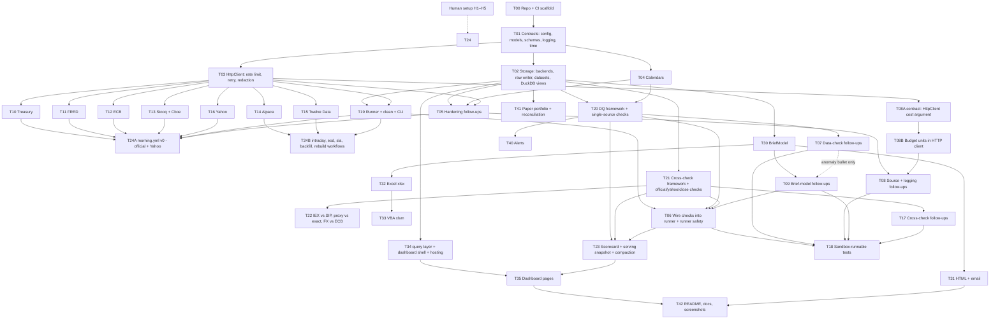

# Desk Brief — Implementation Plan

Status: v1, 2026-11-15; review follow-up cards added 2026-11-16 and 2026-11-17. Source of truth for task order. Spec: `docs/specs/2026-11-15-desk-brief-design.md` (cited as **§n**). Process: `docs/process/agent-workflow.md`.

Rules that apply to every card:
- One card → one branch (`t{id}-{slug}`) → one PR. Target ≤ ~400 changed lines excluding fixtures/lockfile.
- A card may only touch files in its **Owns** list (+ its own tests and fixtures). Anything else → stop, ask the planner.
- `config.yaml` *values* are not contracts: a source card may add or adjust feeds/datasets **for its own source** (disclose in the PR). Other config edits go through the planner (ruling P-004 in `docs/plan/decisions.md`).
- **Contracts** (frozen after Phase 0): `models.py`, `schemas.py`, `sources/base.py`, `store/backend.py` public API, `config.py` models, storage key layout (§6), table schemas (§7.2), Excel table names and column headers (§9.2, P-015). Changing one needs a planner-approved `contract:` PR merged first.
- TDD: failing test first. No network in unit tests. Synthetic data only under `tests/`, labeled.
- Definition of done for every card: acceptance criteria met, `make ci` green locally and in CI, reviewer APPROVE, `docs/agent-log/T{id}.md` entry written (P-014).

---

## 1. Phase overview and dependency graph

### Parallel lanes (max concurrent implementers per window)

| Window | Lane A | Lane B | Lane C | Lane D | Lane E | Lane F |
|---|---|---|---|---|---|---|
| W0 Mon AM | T00 → T01 (sequential, single agent) | | | | | |
| W1 Mon PM | T02 | T03 | T04 | | | |
| W2 Tue | T19 | T10 → T13 | T11 → T12 | T14 | T15 | T16 |
| W3 Tue PM/Wed | T05 → T24A (**ship asap**) | T20 | T21 → T22 | T30 | T34 | |
| W4 Wed/Thu | T24B | T23 | T31 | T32 → T33 | T35 | T40 |
| W5 Fri | T41 | T42 | fixes from run history | | | |

Review follow-ups (T06–T09, T08A, T08B, T17, T18) fill free lanes from W3 on, within the ordering rules in their section. T09 lands before or with T06, and T06 before T23.

Critical path: **T00 → T01 → T02/T03 → T05 + T19 + official sources → T24A** (scheduled runs start) → T20/T21 → T30 → T31 (email live). Everything else hangs off this.

### Timeline

| Date | Target |
|---|---|
| Mon 16 Nov | W0 + W1 merged. Human tasks H1–H5 done (accounts, keys, bucket, repo, branch protection) |
| Tue 17 Nov | W2 merged. T24A merged by evening → **first scheduled morning run Wed 18 11:15 UTC** (2 days earlier than brief) |
| Wed 18 Nov | T20, T21, T22, T30, T34 merged; T24B live (intraday + eod begin history) |
| Thu 19 Nov | T23, T31 (email live), T32, T35 merged |
| Fri 20 Nov | T33 (needs H6), T40, T41, T42. Screenshots |
| Sat–Sun 21–22 | Polish from run history; real incidents written up; user feedback (H8) |
| 23–28 Nov | Buffer; stretch (T50 narrative) only if all DoD met |

Cut order if behind: T41 → T40 → T33 → dashboard pages 5–6. Never cut: T24A, T20–T22, T31, scorecard.

---

## 2. Human tasks (Allen — cannot be done by agents)

| ID | Task | Needed by |
|---|---|---|
| H1 | Accounts + keys: Alpaca (paper account, data API keys), Twelve Data, FRED API key | T24A (Tue) |
| H2 | Cloudflare: create R2 bucket `deskbrief-data` (private); 3 API tokens: `ci-writer` (RW, this bucket), `dashboard-reader` (RO), `admin` | T02 integration, T24A |
| H3 | GitHub repo `desk-brief` (public). Branch protection on `main` per workflow doc §6 (single account, `review/approved` status gate). Secrets per spec §11 | T00 merge |
| H4 | healthchecks.io: two checks (morning, eod) with schedules; email alerts to you | T24A |
| H5 | Gmail app password (or Resend + domain), `REPORT_RECIPIENTS` secret | T31 |
| H6 | In desktop Excel: import `vba/*.bas` into blank `.xlsm`, add buttons, save; run `uv run python -m xlsxwriter.vba_extract` (or the `vba_extract.py` script) → commit `vbaProject.bin` | T33 |
| H7 | Streamlit Community Cloud: deploy `app/Home.py` as private app, add viewer emails, paste `dashboard-reader` secrets | T34 |
| H8 | Send dashboard + report to feedback users; capture feedback verbatim for README | Sat 21 |
| H9 | Verify provider display terms (Alpaca, Twelve Data, Yahoo) before hosted mode shows any T1/T2 market data; record outcome in `docs/terms.md` | T34 |

---

## 3. Task cards

Card format: **Depends** · **Parallel with** · **Owns** · **Spec** · Deliverables · Acceptance criteria · Out of scope.

### Phase 0 — Foundations (sequential)

#### T00 — Repo scaffold and strict CI
- **Depends:** none · **Parallel with:** none
- **Owns:** `pyproject.toml`, `uv.lock`, `Makefile`, `.github/workflows/ci.yml`, `.github/pull_request_template.md`, `.github/dependabot.yml`, `.gitleaks.toml`, `.gitignore`, `.env.example`, `README.md` (stub), `INCIDENTS.md` (template), `docs/agent-log.md`, `docs/glossary.md` (from brief §18), `src/deskbrief/__init__.py`, `tests/conftest.py`
- **Spec:** §13, §14, workflow doc §5–6
- Deliverables: uv project (Python 3.12); deps: pandas, duckdb, pyarrow, httpx, pydantic, pyyaml, structlog, pandera, tenacity, pandas-market-calendars, yfinance, xlsxwriter, jinja2, streamlit, python-ulid; dev: pytest, pytest-cov, pytest-socket, respx, ruff, mypy, pandas-stubs, types-PyYAML. `make ci` = `uv lock --check && ruff check && ruff format --check && mypy --strict src && pytest -m "not integration" --cov=deskbrief --cov-fail-under=85 && gitleaks`. CI jobs: `lint`, `typecheck`, `test`, `security` (gitleaks + `uv` audit if available) as separate required checks; pinned action SHAs; `permissions: contents: read`. Also implement the `contracts` and `pr-hygiene` CI checks from workflow doc §5 (small scripts in `scripts/ci/`, owned by this card), and a `config` job that is a no-op until T01 lands `python -m deskbrief.config`.
- Acceptance: CI green on an empty package with one trivial test; network blocked in tests by default (`--disable-socket` in `pytest.ini` options); PR template contains sections from workflow doc §7.
- Out of scope: any business code.

#### T01 — Contracts
- **Depends:** T00 · **Parallel with:** none
- **Owns:** `config.yaml`, `src/deskbrief/{config.py,models.py,schemas.py,logging.py,timeutil.py,ids.py}`, `src/deskbrief/sources/base.py`, `src/deskbrief/store/backend.py` (Protocol only), `tests/unit/test_config.py`, `tests/unit/test_schemas.py`, `tests/unit/test_logging.py`, `tests/unit/test_timeutil.py`
- **Spec:** §3, §4, §5.1, §6, §7.2
- Deliverables: `python -m deskbrief.config` (validate config, exit non-zero on error; used by CI `config` job); full `config.yaml` with the universe in §3 (all feeds, groups, datasets, thresholds); pydantic models + `load_config()` with validation (every group references existing instruments; every feed references a known source; tiers ∈ {1,2,3}); dataclasses `FetchRequest`, `RawResponse`, `RunContext`, `JobKind`, `DQResult`, `XResult`; pandera schemas for every table in §7.2 exposed as `OBS_SCHEMA`, `SOURCE_LOG_SCHEMA`, …; structlog JSON setup with redaction processor; `timeutil` (utc_now injectable clock, ET conversions, ULID ids); `Source` and `StorageBackend` protocols.
- Acceptance: config loads; invalid configs (dangling group ref, bad tier, unknown source) raise clear errors; redaction test proves `apikey=SECRET` never appears in output; schemas reject wrong dtypes/naive timestamps.
- Out of scope: implementations.

### Phase 1 — Infrastructure + ingestion (parallel)

#### T02 — Storage layer
- **Depends:** T01 · **Parallel with:** T03, T04
- **Owns:** `src/deskbrief/store/{local.py,r2.py,raw.py,datasets.py,duck.py}`, `tests/unit/store/*`, `tests/integration/test_r2.py`
- **Spec:** §2.2, §2.3, §6, §7.3
- Deliverables: `LocalBackend`, `R2Backend` (boto3 or s3fs against R2 endpoint); `put_bytes(overwrite=False)` raises on existing key; `RawWriter.write(raw, ctx) -> key` with sidecar; `Datasets.append(name, df, ctx)` validates with schema and writes `…/date=/run=.parquet`; `duck.connect(store, config)` returns DuckDB connection with httpfs secret (R2) or local paths, registers all §7.3 views incl. `obs_pit` macro and dim views from config; `clean/_CURRENT` pointer read.
- Acceptance: round-trip tests on LocalBackend; write-once enforced; `obs_latest` and `obs_pit` correct on a synthetic multi-version dataset (table-driven); `daily_close` tier preference correct; integration test (marked) writes/reads one object in R2.

#### T03 — HttpClient
- **Depends:** T01 · **Parallel with:** T02, T04
- **Owns:** `src/deskbrief/sources/http.py`, `src/deskbrief/sources/registry.py`, `tests/unit/sources/test_http.py`
- **Spec:** §5.1
- Deliverables: httpx client wrapper; per-source token bucket from config; tenacity retry (timeout, 5xx, 429 honoring Retry-After; no retry 401/403/404); returns `RawResponse` with `error` instead of raising; Twelve Data daily budget tracker (backed by Store via an injected callable, so no T02 dependency); source registry `get_sources(config)`.
- Acceptance: respx tests for each retry path, rate limit timing (fake clock), redaction of query secrets in logged request, budget exhaustion returns `status=budget_exhausted` without HTTP call.

#### T04 — Market calendars
- **Depends:** T01 · **Parallel with:** T02, T03
- **Owns:** `src/deskbrief/calendars.py`, `tests/unit/test_calendars.py`
- Deliverables: `is_business_day(cal, date)`, `prev_business_day`, `session_bounds_utc(date)` for XNYS (incl. early closes), SIFMA_US, TARGET (fixed rules: Jan 1, Good Friday, Easter Monday, May 1, Dec 25, 26).
- Acceptance: Thanksgiving 2026-11-26 closed, 2026-11-27 XNYS early close 13:00 ET, TARGET Good Friday, DST boundary sessions correct.

#### T10 — Treasury par yield curve source
- **Depends:** T03 · **Parallel with:** T11–T16
- **Owns:** `src/deskbrief/sources/treasury.py`, `tests/unit/sources/test_treasury.py`, `tests/fixtures/real/treasury/*`
- Deliverables: plan (morning: D-1; eod: today; backfill: month ranges), fetch, parse → one obs per tenor (`field=yield`, `unit=pct`, `interval=1d`, `as_of` = date 00:00 ET → UTC), instrument mapping via config symbols ("2 Yr", "10 Yr", …).
- Acceptance: golden parse test on a real captured file; empty-month and holiday handled; `docs/sources/treasury.md` probe note (endpoint verified, date, sample size) — included in PR description.

#### T11 — FRED source
- Same shape as T10. **Owns:** `sources/fred.py` + tests/fixtures. Series from config (DGS2, DGS10, DGS20, DGS30, DFF, DCOILWTICO, DCOILBRENTEU, CPIAUCSL, UNRATE). `.` → skip row (not NaN). Request last 10 observations per series per run so revisions are visible. Acceptance includes redaction of `api_key`.

#### T12 — ECB reference rates source
- **Owns:** `sources/ecb.py` + tests. SDMX CSV for USD, GBP, JPY vs EUR; emits raw ECB rates plus derived EURUSD/GBPUSD/USDJPY with `is_derived=true`. Acceptance: cross-rate math test; TARGET holiday empty response → `empty`, not error.

#### T13 — Stooq + Cboe sources
- **Owns:** `sources/stooq.py`, `sources/cboe.py` + tests. Day-1 probe decides: if Stooq is blocked/needs key, implement with `enabled: false` in config and document; Yahoo daily close becomes T3 fallback with `is_fallback=true` (implemented in T16; T13 only sets config `enabled: false` — no code dependency on T16). Cboe VIX history CSV → `VIX` close.

#### T14 — Alpaca source
- **Owns:** `sources/alpaca.py` + tests (synthetic fixtures). Datasets: `iex_latest` (latest trade + quote, multi-symbol), `iex_bars_1m`, `sip_bars_1m` (window must end ≥16 min before now — enforce and test). (`daily_bars` dropped, ruling P-003.) Pagination via `next_page_token`. Acceptance: SIP window guard; pagination; headers never logged.

- Changelog: T01 review: `daily_bars` dropped (P-003).
#### T15 — Twelve Data source
- **Owns:** `sources/twelvedata.py` + tests (synthetic fixtures). `fx_quote` batch for 3 pairs; `fx_series_1m` for a window (ECB fix ±10 min). Budget enforced via T03 tracker. Error payloads with HTTP 200 (`{"status":"error"}`) map to `status=error`.

#### T16 — Yahoo source
- **Owns:** `sources/yahoo.py` + tests (synthetic fixtures). yfinance wrapped: `quote` (fast_info / last price with timestamp) and `history` (daily + 1m). Serializes returned frame + yfinance version as raw JSON. Applies `scale` from feed config (^TNX). Implements `daily_fallback` dataset for T13 fallback. Acceptance: scale applied; empty frame → `empty`; exception → `error` with message.

#### T19 — Pipeline runner, clean step, CLI
- **Depends:** T02, T03 · **Parallel with:** T10–T16 (uses a `FakeSource` in tests)
- **Owns:** `src/deskbrief/pipeline/{runner.py,jobs.py,clean.py,catchup.py,manifest.py}`, `src/deskbrief/cli.py`, `tests/unit/pipeline/*`, `tests/fault_injection/inj_runner_*.py`
- **Spec:** §2.4, §5.4, §5.5
- Deliverables: `deskbrief run {morning|intraday|eod|backfill|rebuild} [--date] [--dry-run] [--sources]`; runner loop per sequence diagram; failure isolation; quarantine; `runs` row with `schedule_delay_s` (from `GITHUB_EVENT_SCHEDULE` / scheduled time); catch-up for missed business days; exit code 0 for ok/degraded, 1 for failed (only when *no* source succeeded or storage unavailable); GHA step-summary markdown writer; `rebuild` writes `clean/v{N+1}` then flips `_CURRENT`.
- Storage rule (P-008, spec §2.4 item 5, §5.5): buffer rows per run and flush once per (table, ET date) in a `finally`, also when degraded; split observations by `et_date(as_of)`. The `runs` row is written **last**, so a run that died mid-flush has no `runs` row and catch-up treats it as missed. Backfill flushes per month chunk so it never buffers more than ~31 days in memory.
- Acceptance: a source raising mid-run still leaves every other source's rows flushed (fault-injection test); a simulated crash before flush leaves raw/ intact and `rebuild` recovers the clean rows; a rerun uses a new `run_id` and causes no `KeyExistsError`.
- Acceptance: fault-injection tests: one source raising, one returning corrupted body, one 429 storm → run `degraded`, other sources' data present, quarantine row + DQ fail written; rerun same date → no duplicate rows in `obs_latest`; catch-up picks up 2 missed days.

- Changelog: PR #6: storage rule per P-008; flush/crash/retry acceptance from the PR #6 round-1 review; runs-row-last and backfill chunking from the round-2 review.
#### T05 — Hardening follow-ups from T01/T02/T04 reviews
- **Depends:** T02, T04 merged; **merge after T03** (T03 imports `redact`/`MASK` from `logging.py`; T05 rebases on it) · **Parallel with:** Phase 1 sources (no shared files) · **Blocks:** T24A (carries the R2 checksum config)
- **Owns:** `src/deskbrief/logging.py`, `src/deskbrief/calendars.py`, `src/deskbrief/store/{local.py,r2.py,raw.py,datasets.py,duck.py}`, `pyproject.toml` + `uv.lock` (only the `pandas-market-calendars` floor), and their tests
- Deliverables (each with a test):
  - logging: add strong names `secret[_-]?key`, `(session|private|auth)[_-]?(token|key)`, and treat `x-auth-token` and `sessionid` both as header/key names and as inline `name=value` tokens (T01 confirmation review #1); structured-key masking covers `private_key`, `auth` (T01 confirmation #4); reduce strong-tier over-masking of placeholder values like `required`, `missing`, `None`, `ok` (T01 confirmation #3); weak-tier keeps `cache_key=SPY:1m:2026-11-14`-style diagnostics readable (T01 confirmation #2). Every probe from all rounds goes into the MUST_MASK / MUST_KEEP tables
  - calendars: `_check_date` rejects non-`date` types with `TypeError`; validate `cal` before empty-range shortcuts; make `cal` keyword-only in `is_early_close(d, *, cal="XNYS")`; add `add_business_days(cal, d, n)` (used by freshness `lag_bdays`); return read-only cached schedules; raise `pandas-market-calendars` floor to the locked major (T04 review; verified by `uv lock --check` in CI, no unit test)
  - storage: backends refuse `overwrite=True` and `delete()` for `raw/` keys; `RawWriter.write` is idempotent on retry (if body exists with the same sha256, continue to sidecar); `Datasets.append` asserts rows belong to `part_date` (P-006); `overwrite` only for `DAILY_TABLES`; R2 boto config `request_checksum_calculation`/`response_checksum_validation` = `when_required`; cache `_CURRENT` per run; escape glob chars in local root (T02 review)
- Acceptance: all of the above tested (except the dependency floor, see above); no contract file changes. The implementer may split the work by area (logging / calendars / storage) if the diff exceeds ~600 lines. If `part` is adopted later (P-008), compaction must accept `run=*-p{n}.parquet`.

- Changelog: PR #6 rounds 1–2: card created from review findings on PRs #2, #3 and #5 (links in the PR #6 body).

### Review follow-ups (from PRs #9–#21)

These cards collect the non-blocking findings that reviewers deferred on PRs #9–#21. Each bullet links its source review. Finding numbers refer to the numbered list in the linked review; "confirmation list" means the second list in a round-2 review. As with T05, a follow-up card may own files of a card that has already merged.

Order and shared files:
- **T09 merges before T06, or in the same window.** Wiring checks into the runner (T06) makes `health_summary` double-count cross-checks until T09 fixes it.
- **T09's anomaly-reuse bullet waits for T07's anomaly change.** The rest of T09 does not wait.
- `pipeline/jobs.py` is shared. T06 edits only the checks hook, T23 only the serving hook (`steps_for`), T31 only the morning row of `steps_for`, and T24B only the intraday branch of `evaluate_gate`. T24B may also need a small `runner.py` edit; it starts that only after T06 has merged. Whichever merges later rebases on the earlier one.
- T18 runs last, after T06–T09 and T17, because it touches test files those cards own.
- T08's Twelve Data budget bullet waits for T08B, which waits for the T08A `contract:` PR. The rest of T08 does not wait.
- Otherwise T07, T08, T08A/T08B and T17 are independent.

#### T06 — Wire checks and cross-checks into the runner; runner safety
- **Depends:** T19, T20, T21 merged; T09 merged first or in the same window · **Parallel with:** T07, T08, T17 · **Blocks:** T23 (scorecard reads `dq_results`/`crosscheck_results` written by real runs)
- **Owns:** `src/deskbrief/pipeline/{runner.py,clean.py,catchup.py,manifest.py}`, the checks hook in `src/deskbrief/pipeline/jobs.py` (shared file, see above), `src/deskbrief/cli.py`, `tests/unit/pipeline/*`, `tests/fault_injection/inj_runner_*.py`
- **Spec:** §2.4, §5.5, §7.2, §8; P-008
- Deliverables:
  - Call `checks.run_checks` from the runner hook in `jobs.py`, after the observations flush, with a single `dq_results` append per (table, ET date) per run (P-008). Source: [PR #16 merge confirmation](https://github.com/allenvarghese05/desk-brief/pull/16#issuecomment-6906878775).
  - Design choice for this card: run the T21 cross-checks in the same hook, so the run makes one `dq_results` append that includes the mirrored `consistency` rows. Write `revisions` and `crosscheck_results` under their §7.2 partition rules. Basis: the T20 card ("runner hook `run_checks(ctx)` writes `dq_results` and `revisions`"), the T21 card ("writes `crosscheck_results` + mirrored `consistency` dq rows") and P-008. The T21 card names no hook, so a separate cross-check hook is acceptable if it keeps a single `dq_results` append per run.
  - Count the check-written DQ rows in the `runs` row (`n_dq_fail`, `n_dq_warn`), not only the runner's own rows. Source: [PR #16 round 1, finding 8](https://github.com/allenvarghese05/desk-brief/pull/16#pullrequestreview-5914480147).
  - Rebuild flip guard: never flip `_CURRENT` to a version with no partitions written; re-check that the pointer has not moved immediately before the flip; two concurrent rebuilds must not both flip. Source: [PR #16 round 2, finding 1](https://github.com/allenvarghese05/desk-brief/pull/16#pullrequestreview-5914845782).
  - Chunk rebuild by month with a single final flip, so memory stays bounded as `raw/` grows. Source: [PR #16 round 1, finding 10](https://github.com/allenvarghese05/desk-brief/pull/16#pullrequestreview-5914480147) and the [author's deferral](https://github.com/allenvarghese05/desk-brief/pull/16#issuecomment-6906415315).
  - An `EMPTY` fetch with no calendar reason writes a DQ `warn` row instead of passing silently. Use the per-dataset expectations from T20. Source: [author's deferral of round-1 finding 9](https://github.com/allenvarghese05/desk-brief/pull/16#issuecomment-6906415315).
- Acceptance:
  - A runner test proves a single `dq_results` append per date per run with checks and cross-checks enabled.
  - A rerun of the same date adds no duplicate check rows.
  - A `source_log` flush failure and a `quarantine` flush failure each give `failed`; a `dq_results`-only loss gives `degraded`. Source: [PR #16 round 2, finding 2](https://github.com/allenvarghese05/desk-brief/pull/16#pullrequestreview-5914845782).
  - Rebuild with zero partitions leaves `_CURRENT` unchanged; a pointer move between write and flip aborts the flip.
- Out of scope: month-chunked backfill (needs a `sources/base.py` contract change; separate `contract:` PR if ever wanted).

- Changelog: card created from the PR #16 reviews linked above and the T20/T21 card text.

#### T07 — Data-check follow-ups
- **Depends:** T20 merged · **Parallel with:** T06, T08, T17 · **Blocks:** T09's anomaly-reuse bullet
- **Owns:** `src/deskbrief/checks/*`, `tests/unit/checks/*`, `tests/fault_injection/*inj_checks*.py`
- **Spec:** §8.1; P-009
- Deliverables (source: [PR #20 review](https://github.com/allenvarghese05/desk-brief/pull/20#pullrequestreview-5914719908) unless noted):
  - Make freshness and completeness agree for a dataset that is due but still within grace: both `skip` with reason "waiting" (finding 1).
  - Intraday freshness: age of the latest tick against the open session (spec §8.1) (finding 2). It needs a per-dataset intraday schedule. A new `config.yaml` value goes through the planner (P-004). A new field on a `config.py` model is a contract change: land a `contract:` PR first.
  - Completeness for Yahoo and Twelve Data datasets, and intraday tick-age freshness. Source: [PR #16 merge confirmation](https://github.com/allenvarghese05/desk-brief/pull/16#issuecomment-6906878775).
  - FRED daily oil (DCOILWTICO, DCOILBRENTEU): do not fail completeness on days SIFMA is open but the oil market is closed (finding 4).
  - Anomaly: score only a move that belongs to the expected data day. A series that stopped updating must not keep reporting its old move (finding 5).
  - Docstring for the eod minute-completeness rule: the 22:30 UTC eod run judges the previous session's bars, per P-009 (finding 6).
  - Rename the fault-injection test file to match the Owns glob, or record why it cannot (finding 7).
- Acceptance: one table-driven test per bullet above; no change to the `dq_results` schema.
- Early closes (P-011, now in spec §8.1): keep T20's early-close behaviour, and make every new check in this card follow it. Minute completeness counts only minutes up to the early close. A missing or late `SIFMA_US` value on a SIFMA recommended early close is at most `warn` (finding 3).

- Changelog: card created from the PR #20 review and the PR #16 merge confirmation; early-close line from P-011.

#### T08A — `contract:` HttpClient cost argument
- **Depends:** T03 merged · **Blocks:** T08B
- **Owns:** `src/deskbrief/sources/base.py` (the `HttpClient` protocol only), as a planner-approved `contract:` PR under the plan's Contracts rule (PR title `contract: 
`), plus the signature of `DefaultHttpClient.get` in `src/deskbrief/sources/http.py`. T08B owns `http.py` after T08A merges.
- Deliverables: add an optional keyword argument to `HttpClient.get` for the number of budget units a request costs, default 1. Add the same defaulted keyword to `DefaultHttpClient.get`, accepted and ignored until T08B, so the runner's `http: HttpClient` typing still checks. No behaviour change.
- Acceptance: the contracts CI check passes with the change declared; mypy passes on every source unchanged.

- Changelog: card created so the contract change T08B needs is tracked, from [PR #22 round 3, finding 3](https://github.com/allenvarghese05/desk-brief/pull/22#pullrequestreview-5925742514); `DefaultHttpClient.get` signature added from [PR #23 round 1, finding 6](https://github.com/allenvarghese05/desk-brief/pull/23#pullrequestreview-5926433510).

#### T08B — Budget units in the shared HTTP client
- **Depends:** T03, T08A merged · **Blocks:** T08's Twelve Data budget bullet
- **Owns:** `src/deskbrief/sources/http.py`, `tests/unit/sources/test_http.py`
- Contract first: the `HttpClient` protocol that `Source.fetch` receives is defined in `src/deskbrief/sources/base.py`, a contract file. Adding a cost argument to `get` is a contract change. It lands first as card T08A, a planner-approved `contract:` PR. T08B does not own `sources/base.py`.
- Deliverables: add a `units` argument (default 1) to `BudgetTracker.try_consume` and implement the new `HttpClient.get` cost argument in `sources/http.py`. Existing callers do not change.
- Acceptance: a test that a cost-5 call consumes 5 units and is refused when fewer remain; all existing source tests pass unchanged.
- Why its own card: every source uses this API, so it lands and is reviewed alone. The source review itself says it "needs a contract change". Source: [PR #17 round 2, finding 2](https://github.com/allenvarghese05/desk-brief/pull/17#pullrequestreview-5914845514).

- Changelog: card created from the PR #17 round-2 review.

#### T08 — Source and logging follow-ups
- **Depends:** T05, T11, T13–T16 merged; T08B for the Twelve Data budget bullet · **Parallel with:** T06, T07, T17
- **Owns:** `src/deskbrief/sources/{alpaca.py,twelvedata.py,cboe.py,stooq.py,yahoo.py,fred.py}`, `src/deskbrief/logging.py`, `pyproject.toml` + `uv.lock` (only the `yfinance` floor), `docs/sources/*`, their tests
- The implementer may split this card by area (one PR per source, plus one for logging) if the diff exceeds ~400 lines, as T05 allowed.
- Deliverables:
  - Twelve Data batch budget: after T08B, count a batch quote as one unit per symbol. Source: [PR #17 round 2, finding 2](https://github.com/allenvarghese05/desk-brief/pull/17#pullrequestreview-5914845514).
  - Twelve Data: test one symbol missing from an otherwise good batch; inline `_new_fetch_id`. Source: [PR #17 round 2, confirmation list findings 1–2](https://github.com/allenvarghese05/desk-brief/pull/17#pullrequestreview-5914845514).
  - Alpaca: when pagination hits the page cap or a repeated token, keep the pages already fetched in raw. Say in the docs that free-plan IEX prices and volume cover one exchange only. Optionally guard SIP windows in `fetch` as well as `plan`. Consider per-symbol quarantine after the live probe. Source: [PR #19 review, findings 1–4](https://github.com/allenvarghese05/desk-brief/pull/19#pullrequestreview-5914847211).
  - Cboe: validate only rows inside the requested window, so one bad historical row does not break every daily run; detect a truncated download that ends mid-number; mark the unverified URL `# UNVERIFIED` in code. Source: [PR #11 review, findings 2–4](https://github.com/allenvarghese05/desk-brief/pull/11#pullrequestreview-5914386201).
  - Convert `csv.Error` in Stooq and `OverflowError` in Cboe to `ParseError`. Source: [PR #11 review, finding 5](https://github.com/allenvarghese05/desk-brief/pull/11#pullrequestreview-5914386201).
  - Yahoo: raise the `yfinance` floor to the 1.x API the code uses; document (or fix) that futures, indices and yields drop today's bar even after the session ends; make the "empty on a US business day means error" rule depend on the symbol set, not only the date. Source: [PR #13 round 2, findings 1–3](https://github.com/allenvarghese05/desk-brief/pull/13#pullrequestreview-5914461338).
  - FRED: add a test that every configured FRED series has an entry in `SERIES_SPECS`, so a new config series fails CI; assert the warning in the skip test; consider logging the skip at error level. Source: [PR #14 review, finding 2](https://github.com/allenvarghese05/desk-brief/pull/14#pullrequestreview-5914397821).
  - Logging: decide each of two known gaps: all-uppercase short-segment credential values kept by the weak tier, and short numeric values kept for strong names (passwords, secrets, API keys) by the placeholder exemption. For each, either tighten the rule and add the probes from the source review as MUST_MASK cases, or record the cases as known-unmasked in the `logging.py` docstring and as MUST_KEEP cases with a comment. The review offers both options. Source: [PR #15 review, findings 1–2](https://github.com/allenvarghese05/desk-brief/pull/15#pullrequestreview-5914412921).
- Acceptance: a test per bullet. T08 makes no change to `sources/base.py`; the protocol change belongs to T08A.
- Out of scope: live probes (owner task; see "Live-probe gates" below).

- Changelog: card created from the PR #11, #13, #14, #15, #17 and #19 reviews linked above.

#### T09 — Brief-model follow-ups
- **Depends:** T30 merged; T07 for the anomaly-reuse bullet · **Parallel with:** T08, T17 · **Blocks:** T06 (or merges in the same window)
- **Owns:** `src/deskbrief/report/model.py`, `src/deskbrief/query.py`, `tests/unit/report/*`, `tests/unit/test_query.py`, `tests/brief_synth.py`
- Deliverables:
  - `health_summary`: do not count a cross-check twice. T21 mirrors each cross-check as a `consistency` row in `dq_results`. Exclude those rows from the DQ count, or count only the mirror. Source: [PR #18 merge confirmation](https://github.com/allenvarghese05/desk-brief/pull/18#issuecomment-6907020326).
  - Where the model shows cross-check rows, label them with `details.ref_date`, not the run's `target_date`. Source: [PR #18 round 2, finding 7](https://github.com/allenvarghese05/desk-brief/pull/18#pullrequestreview-5914906053).
  - Per-row qualifiers (fallback, IEX single exchange, delayed by N minutes) on each `Row`, not only as global known limits. Source: [PR #21 round 1, finding 2](https://github.com/allenvarghese05/desk-brief/pull/21#pullrequestreview-5914850524).
  - After T07: reuse T20's anomaly logic for notable moves instead of a separate z-score. Source: [PR #21 round 1, finding 6](https://github.com/allenvarghese05/desk-brief/pull/21#pullrequestreview-5914850524).
  - Cross-source note when a tick value (for example `UST_10Y` from Yahoo `^TNX`) is compared with an official baseline. Wording for a zero baseline that says the baseline was found and is zero. Source: [PR #21 round 2, confirmation list findings 1–2](https://github.com/allenvarghese05/desk-brief/pull/21#pullrequestreview-5914901602).
  - The golden test must not break on unrelated `config.yaml` edits: compare with `config_hash` masked, or build from a fixture config. Source: [PR #21 round 2, confirmation list finding 3](https://github.com/allenvarghese05/desk-brief/pull/21#pullrequestreview-5914901602).
  - Add baseline rows to the lineage table, so T33 can trace a change to its baseline fetch (the reviewer flagged it "for T33"). Source: [PR #21 round 1, finding 9](https://github.com/allenvarghese05/desk-brief/pull/21#pullrequestreview-5914850524).
  - Add a 2s10s spread row (spec §9.1 sample). It must be derived from two official yields of the same ET date (never a `^TNX` tick minus an official 2Y), shown in bp, and labelled as derived. Source: [PR #21 round 1, deferred items](https://github.com/allenvarghese05/desk-brief/pull/21#pullrequestreview-5914850524).
- Acceptance: a test with mirrored consistency rows proves `health_summary` counts each cross-check once; the golden test passes after a config-only edit; a 2s10s test rejects a tick leg; a test per remaining bullet.

- Changelog: card created from the PR #18 and #21 reviews linked above; `tests/unit/test_query.py` added to Owns from [PR #22 round 3, finding 2](https://github.com/allenvarghese05/desk-brief/pull/22#pullrequestreview-5925742514).

#### T17 — Cross-check follow-ups
- **Depends:** T21 merged · **Parallel with:** T06–T09 (T22 owns different files)
- **Owns:** `src/deskbrief/crosschecks/{base.py,official_pair.py,yahoo_primary.py,close_official.py}`, their tests
- Deliverables (source: [PR #18 round 2](https://github.com/allenvarghese05/desk-brief/pull/18#pullrequestreview-5914906053), confirmation list):
  - Equity leg: exclude a Yahoo tick stamped exactly at the session close (filter `as_of < close`, not `<=`), so it cannot pair with the 15:59 bar and cause a spurious warn. Alternatively, keep it and document the effect in the module docstring (finding 2).
  - Ignore ticks before the session open, and give a pre-market-specific skip reason when no in-session tick exists (finding 3).
  - Add a test with the summer (CEST) fix-window layout: with a Yahoo FX tick from the P-012 fix-time run (12:15 UTC in summer, 13:15 UTC in winter), the FX leg pairs it and passes in both seasons; with no tick in the window, it skips with its specific reason (finding 1).
- Acceptance: tests for a tick at exactly the close, an early-close day, a pre-market-only day and the summer layout.

- Changelog: card created from the PR #18 round-2 review; summer test updated for P-012.

#### T18 — Make the test suite runnable in a sandbox
- **Depends:** T06, T07, T08, T09, T17, T07C, T09C merged (they own most of the test directories below; T07C owns `tests/unit/checks/*` and T09C owns `tests/brief_synth.py`) · **Runs last** among the open follow-up cards
- **Owns:** `tests/conftest.py` (add one repo-root `config.yaml` fixture or constant), the `[tool.pytest.ini_options]` table in `pyproject.toml`. It may make the path-only change to switch these files to that fixture: `tests/unit/test_config.py`, `tests/unit/test_models.py`, `tests/unit/pipeline/{pipeline_fakes.py,test_pipeline_catchup_rebuild.py}`, `tests/unit/{checks,crosschecks,store}/conftest.py`, `tests/unit/sources/test_{fred,twelvedata,alpaca,cboe,stooq}.py`, `tests/fault_injection/test_inj_checks_faults.py`, `tests/brief_synth.py`.
- Deliverables: find why pytest collection touches `.env.example` and stop it; resolve `config.yaml` from the repo root instead of the working directory; keep tests that build an `httpx` client from loading the system CA store when they use respx.
- Acceptance: `pytest -m "not integration"` passes from the repo root under a sandbox that denies `.env*` and the system keychain; CI unchanged.
- Why: reviewers on PRs #16–#21 could not run the suite locally and relied on CI alone. Source: the [PR #16 author response](https://github.com/allenvarghese05/desk-brief/pull/16#issuecomment-6906415315) ("I could not run pytest locally").

- Changelog: card created from the PR #16 author response; T07C and T09C added to Depends, and "Parallel with" replaced, because both own files this card path-edits (wave-3 cards, [PR #49 round-1 review, finding 2](https://github.com/allenvarghese05/desk-brief/pull/49)).

#### Live-probe gates (owner, before T24A's first scheduled run)
Every source card merged with its live probe PENDING and synthetic fixtures only. These are the per-source probes that phase gate G1 calls for, listed so none is missed. Before T24A ships, the owner runs each with real keys and records the result in `docs/sources/<source>.md`:
- Treasury: capture a real file and add the golden parse test the T10 card asks for. Source: [PR #10 round 2, finding 5](https://github.com/allenvarghese05/desk-brief/pull/10#pullrequestreview-5914408475).
- ECB: verify the URL, series key and no-results behaviour, and record the real 404 body and content type. Source: [PR #9 round 2, nit 2](https://github.com/allenvarghese05/desk-brief/pull/9#pullrequestreview-5914469527).
- Stooq: decide `enabled` from the probe. If blocked, set `enabled: false` (T13 card rule). Source: [PR #11 review, finding 1](https://github.com/allenvarghese05/desk-brief/pull/11#pullrequestreview-5914386201).
- Cboe: verify the URL. Source: [PR #11 review, finding 2](https://github.com/allenvarghese05/desk-brief/pull/11#pullrequestreview-5914386201).
- FRED, Alpaca, Twelve Data, Yahoo: one probe each. Sources: [PR #14](https://github.com/allenvarghese05/desk-brief/pull/14#pullrequestreview-5914397821), [PR #19, nit 5](https://github.com/allenvarghese05/desk-brief/pull/19#pullrequestreview-5914847211), [PR #17, nit 6](https://github.com/allenvarghese05/desk-brief/pull/17#pullrequestreview-5914845514), [PR #13](https://github.com/allenvarghese05/desk-brief/pull/13#pullrequestreview-5914461338).

- Changelog: list created from the reviews linked above; it adds no new gate beyond G1.

#### Owner decisions (ruled 2026-11-16)
The four open questions from the follow-up reviews are now ratified rulings in `docs/plan/decisions.md`:

| Topic | Ruling | Where it lands |
|---|---|---|
| Early-close rule | P-011: checks follow each calendar's early close | spec §8.1; T07 |
| FX at the ECB fix | P-012: Yahoo FX quote at the 14:15 Berlin fix every weekday; extra 12:15 UTC cron in summer, existing 13:15 UTC trigger in winter | spec §5.3, §5.4; T24B; T17 test |
| Morning cron form | P-013: two morning crons, one per fire time | spec §5.4; T24A |
| Agent-log location | P-014: one file per card, `docs/agent-log/T{id}.md` | workflow §8.2, §9; definition of done |

### Review follow-ups, wave 2 (from PRs #24–#35)

Non-blocking findings deferred in the second wave. Each bullet links its source. As before, a follow-up card may own files of a merged card, and no two open cards own the same file.

Order:
- T07A (contract) before T07B.
- T09B before T32B, and T32B before T33.
- T22B, T26 and T06D are independent of each other and of the rest.

#### T07A — `contract:` per-dataset intraday schedule
- **Depends:** T07 merged · **Blocks:** T07B
- **Owns:** `src/deskbrief/config.py` (one new model and one `Config` field only), as a planner-approved `contract:` PR (Contracts rule); `config.yaml` values via the planner (P-004); config tests
- Deliverables: `IntradaySchedule(source, dataset, calendar="XNYS", grace_minutes=30)` and `Config.intraday: tuple[IntradaySchedule, ...] = ()`, cross-referenced against feeds like `datasets`. Values: `alpaca/iex_latest`, `yahoo/quote` and `twelvedata/fx_quote`, each with 30 minutes grace (two missed 15-minute polls).
- Source: the T07 implementer's proposal in the [PR #27 description](https://github.com/allenvarghese05/desk-brief/pull/27) and the [PR #27 round-2 review, finding 1](https://github.com/allenvarghese05/desk-brief/pull/27#pullrequestreview-5932068771).

- Changelog: card created from PR #27.

#### T07B — Intraday tick-age freshness
- **Depends:** T07A · **Owns:** `src/deskbrief/checks/*`, `tests/unit/checks/*`
- Deliverables: age of the newest tick against `grace_minutes` for each `Config.intraday` entry. It runs only inside the session (early-close aware, P-011) and at least one grace period after the open, and gives `skip` otherwise. It uses the existing warn/fail ladder.
- Acceptance: tests for in-session fresh and stale ticks, pre-open, an early close and a holiday.

- Changelog: card created from PR #27 (the deferred T07 bullet).

#### T09B — Brief-model follow-ups 2
- **Depends:** T07, T09 merged · **Blocks:** T32B · **Owns:** `src/deskbrief/report/model.py`, `src/deskbrief/query.py`, `tests/unit/report/test_model.py`, `tests/unit/report/golden/*`, `tests/unit/test_query.py`, `tests/brief_synth.py`
- Deliverables:
  - Reuse T20/T07's anomaly logic for notable moves (the deferred T09 bullet).
  - `health_summary` and the cross-check items read only the latest run for each `target_date`. Re-runs keep both runs' rows under P-008. Source: [PR #32 review, finding 2](https://github.com/allenvarghese05/desk-brief/pull/32#pullrequestreview-5932131226).
  - `Row.dq_flag`: the worst check or cross-check status for the instrument on the report date, for T32B (P-015).
  - Typed numeric `value` and `value_unit` on derived rows (the 2s10s spread in bp), so writers stop parsing text. Source: [PR #33 review, finding 2](https://github.com/allenvarghese05/desk-brief/pull/33#pullrequestreview-5932128409).
  - `exclude_tiers=` on `latest_snapshot` and `overnight_changes`, so hosted mode falls back to a tier 2/3 value instead of hiding the instrument. Source: the T34 implementer's note in the [PR #37 description](https://github.com/allenvarghese05/desk-brief/pull/37).
  - A test that the 2s10s spread ignores a tier-2 `1d` yield. A future-dated quote shows a warning instead of "0 min old". A docstring on the spread's shared date. Source: [PR #28 review, findings 1–3](https://github.com/allenvarghese05/desk-brief/pull/28#pullrequestreview-5931993002).
- Acceptance: a test per bullet; `SCHEMA_VERSION` stays 1 if every new field has a default.

- Changelog: card created from the PR #28, #32, #33 and #37 sources linked above.

#### T32B — Excel columns before T33
- **Depends:** T09B · **Blocks:** T33 · **Owns:** `src/deskbrief/report/excel.py`, `tests/contract/test_excel_tables.py`, `tests/unit/report/test_excel.py`, `tests/xlsx_read.py`
- Deliverables:
  - Append `dq_flag` and `as_of_utc` to the five market tables exactly as spec §9.2 lists them (P-015).
  - Values for `dq_flag`: `fail`, then `warn`, then `pass`, taking the worst over the instrument's checks and cross-checks on the report date. `skip` counts as no result, and an instrument with no result gets `none`.
  - `as_of_utc`: ISO 8601 UTC text, for example `2026-11-16T11:58:00Z`, stored as text so VBA reads it the same everywhere. Blank when the value is unavailable.
  - Write typed derived values from T09B, and remove `_parse_bp`.
  - Export the placeholder label as a constant and set the placeholder's `status` to `empty`. Note in the T33 card handoff that macros skip the placeholder row.
  - Replace the FX-format magic number with a named constant.
  - Cover Notable, the IEX and fallback qualifiers, and lineage `is_fallback` in tests. Source: [PR #33 review, findings 2, 3, 5 and 6](https://github.com/allenvarghese05/desk-brief/pull/33#pullrequestreview-5932128409).
- Acceptance: the contract test pins the new headers; a negative-spread test.

- Changelog: card created from the PR #33 review and P-015.

#### T22B — Cross-check follow-ups 2
- **Depends:** T22 merged · **Owns:** `src/deskbrief/crosschecks/{fx_ecb.py,iex_sip.py}`, their tests
- Deliverables:
  - fx_vs_ecb: the Twelve Data price comes from the bar starting at 14:15, which closes about a minute after the fix. Use the bar ending at the fix, or document the offset. Give a specific Yahoo skip reason ("no ticks" vs "no tick within ±1m"). Pin the ±1-minute tolerance with ticks at +60 s, +61 s and −60 s. Add tests that rows ingested after `now_utc` are ignored and that the latest version wins. Compute `_is_derived` once per pair. Source: [PR #30 review, findings 1–5](https://github.com/allenvarghese05/desk-brief/pull/30#pullrequestreview-5932010935).
  - iex_vs_sip: add `left_label`/`right_label` saying IEX is a single venue and SIP is consolidated. Add a p95 nearest-rank test with 95 clean and 5 bad minutes. Clamp or comment `n_missing_both`. Source: [PR #29 review, findings 1–3](https://github.com/allenvarghese05/desk-brief/pull/29#pullrequestreview-5932008561).
- Acceptance: a test per bullet.

- Changelog: card created from the PR #29 and #30 reviews.

#### T26 — Futures roll calendar
- **Depends:** T22 merged · **Owns:** `src/deskbrief/crosschecks/proxy_exact.py`, its tests, a `crosschecks.roll_calendar` block in `config.yaml` via the planner (P-004)
- Deliverables: replace the ES_F and BRENT roll-window approximations with rules taken from the exchange calendars (CME for ES and CL, ICE for Brent, COMEX for GC), and model WTI and GOLD_F too. Record the source URL and date in `docs/sources/` (VERIFY by the owner).
- Acceptance: a window-length test per contract over a year, and each roll date checked against the cited calendar.
- Source: [PR #31 round 1, finding 1](https://github.com/allenvarghese05/desk-brief/pull/31#pullrequestreview-5932027859) and [round 2, nit 3](https://github.com/allenvarghese05/desk-brief/pull/31#pullrequestreview-5932099384).

- Changelog: card created from the PR #31 reviews.

#### T06D — Rebuild follow-ups
- **Depends:** T06 merged · **Owns:** `src/deskbrief/pipeline/clean.py`, `tests/unit/pipeline/test_pipeline_rebuild_safety.py`, `tests/fault_injection/inj_runner_rebuild.py`
- Deliverables:
  - The abort reason names the `clean/_flips/from-{previous}` marker key and the operator step, and the marker stores the flip time.
  - A test that a non-`KeyExistsError` claim-write failure gives `failed`, no flush and an unchanged pointer.
  - Optional cleanup of abandoned version directories.
- Source: [PR #35 review, findings 1–3](https://github.com/allenvarghese05/desk-brief/pull/35#pullrequestreview-5932290937).

- Changelog: card created from the PR #35 review.

### Review follow-ups, wave 3 (from PRs #37 and #40–#48)

Non-blocking findings deferred in the third wave. Each bullet links its source. As before, a follow-up card may own files of a merged card, and no two open cards own the same file.

Order:
- T09C before T34B (T34B uses T09C's `exclude_tiers` pass-through).
- T07C, T22C, T23C and T06E are independent of each other and of the other open cards.
- T18 runs after T07C and T09C, which own test files that T18 path-edits (see T18's Depends).
- T09C does not block T33. Until it merges, macros must not rely on `as_of_utc` for `UST_2S10S` (see the T33 card).

Not carried: the two PR #41 nits. The stale PR-body line needs no action, and the duplicate-entry message in `config.py` matches the `datasets` message and would need a `contract:` PR to change. Source: [PR #41 review](https://github.com/allenvarghese05/desk-brief/pull/41#pullrequestreview-5933282565).

#### T07C — Check follow-ups 3
- **Depends:** T07B merged · **Owns:** `src/deskbrief/checks/{feed_completeness.py,freshness.py,base.py}`, `tests/unit/checks/*`
- Deliverables:
  - `feed_completeness` covers `alpaca/iex_latest`: at least one tick per configured Alpaca instrument inside the XNYS session, with the same session, early-close and holiday handling as the Yahoo and Twelve Data tick rules. Alpaca's `as_of` is the last-trade time, so the rule asks only that the instrument appears, not that its tick is recent: an illiquid ETF must not fail. `freshness_intraday` keeps judging the feed as a whole. Source: [PR #46 review, finding 1](https://github.com/allenvarghese05/desk-brief/pull/46#pullrequestreview-5933420789).
  - A test for the `as_of <= now` guard in `newest_tick`: a tick with `as_of = now + 5 min` and `ingested_at <= now` is ignored, giving `no_ticks` or an older tick's age. Source: [PR #46 review, finding 2](https://github.com/allenvarghese05/desk-brief/pull/46#pullrequestreview-5933420789).
  - The `freshness_intraday` row of the docstring table in `checks/base.py` fits on one line. Source: [PR #46 review, finding 3](https://github.com/allenvarghese05/desk-brief/pull/46#pullrequestreview-5933420789).
  - This card's own agent log, `docs/agent-log/T07C.md`, records that `docs/agent-log/T07B.md` overstated `feed_completeness`'s coverage until this card. T07B.md itself is not edited. Source: [PR #46 review, finding 1](https://github.com/allenvarghese05/desk-brief/pull/46#pullrequestreview-5933420789).
- Acceptance: tests for an Alpaca instrument missing in session (fail), present but old (pass), pre-open, an early close and a holiday (skip); the guard test fails if the guard is removed.

- Changelog: card created from the PR #46 review.

#### T22C — Cross-check follow-ups 3
- **Depends:** T22B merged · **Owns:** `src/deskbrief/crosschecks/fx_ecb.py`, `tests/unit/crosschecks/test_xc_fx_ecb.py`
- Deliverables:
  - The docstring and the `BAR_LENGTH` comment say the bar-start convention is unverified until the Twelve Data live probe, and that `BAR_LENGTH` becomes 0 if `datetime` turns out to be the bar end.
  - The `_is_derived` test adds an ECB row for one derived cross and asserts that both source rows carry the same `right_is_derived`.
  - The Yahoo skip reason formats the tolerance from seconds (or from `TICK_TOLERANCE` directly), so a non-whole-minute tolerance prints correctly.
  - A comment that `n_yahoo_ticks` counts ticks in the ±10-minute window here, unlike `yahoo_vs_primary`.
- Source: [PR #42 review, findings 1–4](https://github.com/allenvarghese05/desk-brief/pull/42#pullrequestreview-5933261782).
- Acceptance: a test per behaviour bullet.

- Changelog: card created from the PR #42 review.

#### T09C — Report follow-ups
- **Depends:** T09B, T32B, T31B merged · **Blocks:** T34B · **Owns:** `src/deskbrief/report/{model.py,html.py,excel.py,notify.py}`, `src/deskbrief/query.py` (docstring only), `tests/unit/report/*`, `tests/unit/test_query.py`, `tests/brief_synth.py`, `tests/xlsx_read.py`
- Deliverables:
  - `Row.as_of` for the 2s10s spread: the shared date stamp of the two yields, so Excel `as_of_utc` is no longer blank for `UST_2S10S`. The Excel test asserts the new value. Source: [PR #47 review, findings 3 and 5](https://github.com/allenvarghese05/desk-brief/pull/47#pullrequestreview-5933580186).
  - The spread's tail says "change unavailable (no earlier common date)" when there is only one common date, so the HTML caption stops repeating the value. A test builds an n/a row through the real model path, not a hand-built description, and asserts the caption. Source: [PR #43 review, findings 1 and 2](https://github.com/allenvarghese05/desk-brief/pull/43#pullrequestreview-5933289273).
  - Excel: a test pins `as_of_utc` for one official daily row (the stored midnight-ET stamp), and the `AS_OF_UTC_FORMAT` comment says official values carry a date stamp, not a publish time. A test pins the FX four-decimal boundary with a rate near 150 next to a major pair. Source: [PR #47 review, findings 1 and 2](https://github.com/allenvarghese05/desk-brief/pull/47#pullrequestreview-5933580186).
  - `BriefModel.from_store` takes a keyword-only `exclude_tiers=()` and passes it to every `query.py` read that already accepts it, so the dashboard can build a hosted model with tier 1 excluded. Default `()` keeps every existing caller unchanged. Source: [PR #37 review, finding 1](https://github.com/allenvarghese05/desk-brief/pull/37#pullrequestreview-5932793791) (T09B added the parameter to `query.py` only).
  - The `health_summary` docstring and the Known-limits text say that a partial re-run supersedes both check tables for its date. Source: [PR #44 round-2 review, finding 1](https://github.com/allenvarghese05/desk-brief/pull/44#pullrequestreview-5933450119).
  - notify: the scrubbed `NotifyError` also has no `__context__` holding the raw exception. The concurrent-archive test flags `overwrite=True` instead of checking for a default value. Source: [PR #43 review, findings 3 and 4](https://github.com/allenvarghese05/desk-brief/pull/43#pullrequestreview-5933289273).
  - Optional: a `_COMPLETE` marker written last in each archive version, so a partial version is visible. Source: [PR #43 review, finding 5](https://github.com/allenvarghese05/desk-brief/pull/43#pullrequestreview-5933289273).
- Acceptance: a test per bullet; the Excel contract test is unchanged (no header changes); `SCHEMA_VERSION` stays 1.

- Changelog: card created from the PR #43, #44 and #47 reviews; `from_store` pass-through moved here from T34B, because T34B does not own `model.py` ([PR #49 round-1 review, finding 3](https://github.com/allenvarghese05/desk-brief/pull/49)).

#### T23C — Scorecard, serving and compaction follow-ups
- **Depends:** T23, T23B merged · **Owns:** `src/deskbrief/scorecard.py`, `src/deskbrief/pipeline/serving.py`, `src/deskbrief/store/compaction.py`, `tests/unit/test_scorecard.py`, `tests/unit/test_serving.py`, `tests/unit/test_compaction.py`, `tests/unit/t23_synth.py`, `docs/agent-log/T23B.md` (the stale "Decisions" line only)
- Deliverables:
  - The scorecard and the serving build share one DuckDB connection per job, re-reading the scorecard after its write. Measure the intraday serving step before and after and put both numbers in the PR. Source: [PR #45 round-2 review, finding 1](https://github.com/allenvarghese05/desk-brief/pull/45#pullrequestreview-5933525550).
  - The backfill test also asserts `scorecard_30d.parquet`. `parts` is a list literal. Source: [PR #45 round-2 review, findings 3 and 4](https://github.com/allenvarghese05/desk-brief/pull/45#pullrequestreview-5933525550).
  - The compaction window test checks day 6, the oldest included date, so `RECENT_DAYS = 6` fails it. A serving test with `now_utc` late in the UTC day (after 20:00 ET in winter) asserts the window counts back from the ET date. Source: [PR #48 round-2 review, findings 1 and 2](https://github.com/allenvarghese05/desk-brief/pull/48#pullrequestreview-5933765825).
  - `_compact_all` resolves the clean version once and passes `clean_version=` to every partition. Re-wrap the `serving.py` module docstring. Source: [PR #48 round-2 review, findings 4 and 5](https://github.com/allenvarghese05/desk-brief/pull/48#pullrequestreview-5933765825).
  - `docs/agent-log/T23B.md` says the last 7 ET days are compacted, and older partitions only by a manual call. Source: [PR #48 round-2 review, finding 3](https://github.com/allenvarghese05/desk-brief/pull/48#pullrequestreview-5933765825).
- Acceptance: a test per behaviour bullet; each mutation named above fails a test.

- Changelog: card created from the PR #45 and #48 reviews.

#### T06E — Rebuild follow-ups 2
- **Depends:** T06D merged · **Owns:** `src/deskbrief/pipeline/clean.py`, `tests/unit/pipeline/test_pipeline_rebuild_safety.py`, `tests/fault_injection/inj_runner_rebuild.py`
- Deliverables:
  - The marker test asserts that `flipped_at` equals the rebuild's injected clock.
  - The abort test asserts the full "delete clean/_flips/from-v1" phrase.
  - The abort reason adds: "if you did not roll back by hand, check `flipped_at` in the marker body first", since a rebuild killed between the claim and the pointer write leaves the same marker.
  - A comment on the parametrized claim-failure test says why its two cases assert different things.
  - Optional, carried from T06D: delete abandoned version directories. Abandoned means a `clean/v{N}/` that is not the version in `_CURRENT`, has no `clean/_flips/from-*` marker naming it as `new_version`, and was last written more than 7 days ago. If done, tests show that `_CURRENT`'s version, a flipped-to version and a recent in-progress version are never deleted. Source: the deferred-cleanup item in the [PR #40 review](https://github.com/allenvarghese05/desk-brief/pull/40#pullrequestreview-5933274186) acceptance list.
- Source: [PR #40 review, findings 1–4](https://github.com/allenvarghese05/desk-brief/pull/40#pullrequestreview-5933274186).
- Acceptance: a test per behaviour bullet.

- Changelog: card created from the PR #40 review.

#### T34B — Dashboard follow-ups
- **Depends:** T34, T09C merged · **Owns:** `app/Home.py`, `app/theme.py`, `app/components/*`, `tests/unit/app/{test_home.py,test_components.py,conftest.py}`
- Deliverables:
  - Hosted mode passes its hidden tiers to `BriefModel.from_store(..., exclude_tiers=...)` (T09C) in `build_snapshot`, so an instrument whose latest value is tier 1 falls back to tier 2 or 3 instead of disappearing. The `series_all` history keeps its current per-mode filter. The cached reader's key includes the hidden tiers, so hosted and local snapshots never share a cache entry. Source: [PR #37 review, finding 1](https://github.com/allenvarghese05/desk-brief/pull/37#pullrequestreview-5932793791).
  - `Home.py` also catches `duckdb.Error` and `OSError` as "Cannot read the data store", without echoing the message. A test covers an unreachable store, not just missing credentials. Source: [PR #37 review, finding 2](https://github.com/allenvarghese05/desk-brief/pull/37#pullrequestreview-5932793791).
  - The `theme.py` docstring stops promising stale greying. `overview()` in `app/components/data.py` appends dashboard limits to the model's `known_limits` for the Known limits expander: no stale greying, no z column, no curve panel, no live polling, and a 30-day sparkline instead of the spec's 1-day one. Source: [PR #37 review, finding 3](https://github.com/allenvarghese05/desk-brief/pull/37#pullrequestreview-5932793791).
  - `panels.py` raises `ValueError` instead of `assert`, and tests `row.change is not None` instead of the `"n/a"` text. Source: [PR #37 review, finding 4](https://github.com/allenvarghese05/desk-brief/pull/37#pullrequestreview-5932793791).
- Acceptance: AppTest cases for the hosted fallback and the unreachable store; a test per remaining behaviour bullet.

- Changelog: card created from the PR #37 review (the `query.py` half shipped in T09B); depends on T09C for the `from_store` pass-through, cache key and Known-limits location made explicit, from the [PR #49 round-1 review, findings 3 and 5](https://github.com/allenvarghese05/desk-brief/pull/49).

### Phase 2 — Scheduling, quality, cross-checks

#### T24A — `morning.yml` v0 (ship first)
- **Depends:** T19, T10, T11, T12, T13, T16, T05 · **Parallel with:** T20–T22, T30, T34
- **Owns:** `.github/workflows/morning.yml`, `docs/runbook.md`
- Deliverables: two crons, `15 10 * * 1-5` and `15 11 * * 1-5` (P-013; DST-safe, code gates) + `workflow_dispatch`; concurrency group; uv cache; secrets env; runs `deskbrief run morning`; pings healthcheck on success, `/fail` on failure; uploads logs as artifact (7-day retention, contains no provider data beyond counts).
- The job sets `GITHUB_EVENT_SCHEDULE: ${{ github.event.schedule }}` in its environment, so the morning gate's `scheduled_for` sees the exact fire (P-013). Test or dispatch evidence: a scheduled run's step summary shows the fire time it gated on.
- `docs/runbook.md` covers manual rollback of `clean/_CURRENT`: delete `clean/_flips/from-{previous}` before rebuilding from a rolled-back version. Source: [PR #35 review, finding 1](https://github.com/allenvarghese05/desk-brief/pull/35#pullrequestreview-5932290937).
- The job passes the T31 SMTP settings (`SMTP_USER`, `SMTP_APP_PASSWORD`, `REPORT_RECIPIENTS`, optional `SMTP_HOST`/`SMTP_PORT`) as secrets. Source: the [PR #36 description](https://github.com/allenvarghese05/desk-brief/pull/36).
- **Depends also on T05** (R2 checksum config). Gate: the owner runs `tests/integration/test_r2.py` with real keys **on `main` at or after the T05 merge**, and the commit SHA plus the pass output are pasted into the T24A PR description.
- Acceptance: workflow sets `DESKBRIEF_STORAGE_BACKEND=r2` (config default is `local` for dev); manual dispatch run green against real sources writes raw/clean/runs to R2 (screenshot/log excerpt in PR); job shows step summary. Report generation is a no-op until T31.

- Changelog: PR #6: depends on T05; R2 gate from the T02 review (PR #5) finding 5; gate wording from the PR #6 round-1 review; two morning crons from P-013; runbook and SMTP lines from PRs #35 and #36; `GITHUB_EVENT_SCHEDULE` mapping from [PR #23 round 2, finding 3](https://github.com/allenvarghese05/desk-brief/pull/23#pullrequestreview-5926563588).
#### T20 — DQ framework + single-source checks
- P-009: checks needing reproducible daily values read `obs_pit`, never `daily_close`, and exclude the current unfinished ET date.
- **Depends:** T02, T04 · **Parallel with:** T21, T30, T34
- **Owns:** `src/deskbrief/checks/*`, `tests/unit/checks/*`, `tests/fault_injection/inj_checks_*.py`
- Spec §8.1. Seven types: freshness, completeness, calendar, validity, uniqueness, anomaly, revision (consistency comes from T21). Each `Check.evaluate(ctx, duck) -> list[DQResult]`; registry; runner hook `run_checks(ctx)` writes `dq_results` and `revisions`.
- Acceptance: table-driven tests per check incl. holiday → `skip`; injected stale price → freshness fail; injected ×10 unit flip → validity/anomaly fail; FRED revision → revisions row + warn.

- Changelog: PR #6: P-009 line.
#### T21 — Cross-check framework + official_pair, yahoo_vs_primary, close_vs_official
- P-009: daily comparisons read `obs_pit` and exclude the current unfinished ET date; result details carry each side's `field`/`unit`.
- **Depends:** T02 · **Parallel with:** T20
- **Owns:** `src/deskbrief/crosschecks/{base.py,official_pair.py,yahoo_primary.py,close_official.py}`, tests
- Deliverables: `CrossCheck` protocol, bps math helpers (level diff for yields in bp; relative diff for prices), writes `crosscheck_results` + mirrored `consistency` dq rows.
- Acceptance: synthetic cases for pass/warn/fail at boundaries; missing side → `skip` with reason.

- Changelog: PR #6: P-009 line.
#### T22 — iex_vs_sip, proxy_vs_exact, fx_vs_ecb
- P-009: `fx_vs_ecb` labels the ECB side as "ECB reference rate" (`field=rate`), not a close; the comparison reads `obs_pit`.
- **Depends:** T21 · **Owns:** `crosschecks/{iex_sip.py,proxy_exact.py,fx_ecb.py}`, tests
- Acceptance: minute alignment (missing minutes excluded, counted); inverse-duration expected move math tested (TLT D=16.5, Δy=+10bp → −1.65%); direction-disagreement rule; 14:15 CET fix time across DST.

- Changelog: PR #6 round 2: P-009 line.
#### T23 — Scorecard, serving snapshot, compaction
- **Depends:** T20, T21, T06 · **Owns:** `src/deskbrief/{scorecard.py}`, `pipeline/serving.py`, `store/compaction.py`, tests; edits the `pipeline/jobs.py` serving step (allowed; shared file, see Review follow-ups)
- Deliverables: `scorecard_daily` from source_log + crosscheck disagreements; serving files (§6) written at end of every job; compaction with row-count verification before delete.
- Acceptance: scorecard numbers correct on synthetic log; compaction preserves all distinct versions; serving snapshot contains tier/as-of/source for every headline instrument.
- Cross-check rows carry the run's `target_date`; label them with `details.ref_date`, the date actually compared.

- Compaction must accept rebuild files named `run={run_id}-{YYYY-MM}.parquet` (T06 part 2; rows keep the real `run_id`). The scorecard reads only the latest run for each `target_date`. Source: [PR #35 review, finding 4](https://github.com/allenvarghese05/desk-brief/pull/35#pullrequestreview-5932290937) and [PR #32 review, finding 2](https://github.com/allenvarghese05/desk-brief/pull/32#pullrequestreview-5932131226).

- Changelog: depends on T06 (real runs write the check tables it reads), and the `jobs.py` serving-step edit made explicit, from [PR #22 round 2](https://github.com/allenvarghese05/desk-brief/pull/22#pullrequestreview-5925693019); `ref_date` labelling from [PR #18 round 2, finding 7](https://github.com/allenvarghese05/desk-brief/pull/18#pullrequestreview-5914906053) and [author response](https://github.com/allenvarghese05/desk-brief/pull/18#issuecomment-6906900231); rebuild file names and latest-run reading from the PR #35 and #32 reviews.

#### T24B — Remaining workflows
- **Depends:** T14, T15, T19 · **Owns:** `.github/workflows/{intraday,eod,sla,backfill,rebuild}.yml`; edits the intraday branch of `evaluate_gate` in `pipeline/jobs.py` (allowed; shared file, see Review follow-ups); only if needed for Yahoo-only enforcement, a small edit in `pipeline/runner.py` after T06 merges
- Acceptance: each dispatches green; intraday exits early outside session; sla fails if report missing; backfill accepts inputs.
- `sla.yml` catches a missing report for any cause, such as a morning run that never starts.
- From the [PR #24 review](https://github.com/allenvarghese05/desk-brief/pull/24#pullrequestreview-5931869851), findings 1–2:
  - `Gate` carries a source restriction that `run_job` applies, so the `--sources yahoo` flag is needed only on the 12:15 cron.
  - The intraday gate uses `scheduled_for`, and `intraday.yml` maps `github.event.schedule` into `GITHUB_EVENT_SCHEDULE`, with a delayed-run test (scheduled 12:15, now 12:40 CEST, proceeds).
- ECB-fix FX fetch (P-012):
  - `intraday.yml` adds cron `15 12 * * 1-5`.
  - The fix-window rule lives in one place, the intraday branch of `evaluate_gate`: a run proceeds outside the NYSE session when its `scheduled_for` time (wall clock if unknown, as for the morning gate) is within ±10 min of 14:15 Europe/Berlin on a TARGET business day. This check comes before the "not an XNYS business day" check, so it also covers US holidays when TARGET is open (Thanksgiving, July 4 and similar).
  - An exempted run fetches Yahoo only. The workflow passes `--sources yahoo` on the 12:15 trigger and on any trigger the gate exempts. If the gate also has to enforce Yahoo-only (it takes no `sources` argument today), the small `runner.py` change goes in this card with a note in the PR, merged after T06 or rebased on it. Yahoo's intraday `quote` dataset includes `EURUSD=X`.
  - Any other trigger outside the session exits `skipped` as today, including the 12:15 trigger in winter and on TARGET holidays.
  - No Twelve Data request is added: the leg reads the `fx_series_1m` bars from eod.
  - The exempted run passes through the T06 checks hook and the T23 serving hook. It must not raise a false freshness failure for the sources it did not fetch, and must not replace the latest serving view with a Yahoo-only one.
  - Tests:
    - a CEST date at 12:15 UTC and a CET date at 13:15 UTC each proceed and plan Yahoo requests only;
    - Thanksgiving (XNYS closed, TARGET open) at 13:15 UTC proceeds Yahoo-only;
    - a CET date at 12:15 UTC and a TARGET holiday are `skipped`;
    - a 13:45 UTC CET run outside the session is still `skipped`;
    - an exempted run leaves freshness results for other sources unchanged and the serving view intact.

- Changelog: late-cron safety net from the [PR #16 author's note on finding 4](https://github.com/allenvarghese05/desk-brief/pull/16#issuecomment-6906415315); summer FX run from [PR #18 round 2, confirmation list finding 1](https://github.com/allenvarghese05/desk-brief/pull/18#pullrequestreview-5914906053), ruled in P-012 (winter half from [PR #23 round 1, finding 1](https://github.com/allenvarghese05/desk-brief/pull/23#pullrequestreview-5926433510)); `evaluate_gate` edit for it; single window rule, US-holiday order, `scheduled_for` gating, Yahoo-only planning and hook safety from [PR #23 round 2, findings 1, 2, 4 and 6](https://github.com/allenvarghese05/desk-brief/pull/23#pullrequestreview-5926563588); `sla.yml` wording from [PR #23 round 1, finding 5](https://github.com/allenvarghese05/desk-brief/pull/23#pullrequestreview-5926433510); Gate source restriction and intraday `scheduled_for` from the PR #24 review.

### Phase 3 — Outputs

#### T30 — BriefModel
- P-009: the model labels each value by `field`/`unit` ("10Y yield", "ECB reference rate", "close"); "change since previous NYSE close" applies only to `field=close` instruments, others say "since previous official value"; values come from `obs_pit(report_time)`.
- **Depends:** T02 (uses §7.2 schemas; can test on fixture store before T20/T21 merge) · **Owns:** `src/deskbrief/report/model.py`, `src/deskbrief/query.py` (shared read API: `latest_snapshot`, `overnight_changes`, `health_summary`, `series`, `lineage`), tests
- Acceptance: for `field=close` instruments the overnight change uses the previous NYSE close (Monday → Friday); yields and ECB rates use the previous official value and are labelled per P-009 (test case for a yield and for an ECB rate); yields in bp, prices in %; known-limits list built from config labels + today's failures; model JSON-serializable; deterministic snapshot test.

- Changelog: PR #6: P-009 line and reworded overnight-change acceptance (round-1 and round-2 reviews).
#### T31 — HTML report + email
- P-009: labels rendered from the model's field/unit labels, never a hard-coded "close".
- **Depends:** T30 · **Owns:** `report/html.py`, `report/notify.py`, `report/templates/*`, tests; edits `pipeline/jobs.py` morning step (allowed)
- Acceptance: email-safe HTML (inline CSS, table layout, no JS); tier glyphs + proxy labels present; footer honesty line; `Notifier` protocol with `SmtpNotifier` and `NullNotifier` (dry-run); email failure → run `degraded` + alert, report still archived.
- Cross-check rows carry the run's `target_date`; render the model's `details.ref_date` label (T09 decides it), never `target_date`.

- Changelog: PR #6: P-009 line; `ref_date` labelling from [PR #18 round 2, finding 7](https://github.com/allenvarghese05/desk-brief/pull/18#pullrequestreview-5914906053) and [author response](https://github.com/allenvarghese05/desk-brief/pull/18#issuecomment-6906900231).
#### T32 — Excel `.xlsx`
- P-009: a `field`/`label` column in every data table; the About sheet explains close vs yield vs reference rate.
- **Depends:** T30 · **Owns:** `report/excel.py`, `tests/contract/test_excel_tables.py`
- Acceptance: sheet and table names/headers exactly as §9.2 (contract test — VBA depends on it); number formats; About sheet labels.

- Changelog: PR #6: P-009 line.
#### T33 — VBA `.xlsm`
- P-009: macros never relabel values; the `label`/`field` column from T32 is kept visible.
- **Depends:** T32, T32B, H6 · **Owns:** `vba/*`, `report/vba.py`, `tests/contract/test_vba_manifest.py`, CI step in `ci.yml` (allowed edit: add `vba-manifest` job)
- Handoff from T32B: macros skip rows whose `status` is `empty` (P-016). Until T09C merges, `as_of_utc` is blank for `UST_2S10S`, so macros must not rely on it for that row.
- Acceptance: `.bas` modules reference only §9.2 names; `.xlsm` produced when `vbaProject.bin` exists, skipped with warning otherwise; manifest check fails on drift; README macro-unblock note.

- Changelog: PR #6 round 2: P-009 line; depends on T32B and uses the spec §9.2 headers per P-015 ([PR #33 review, findings 1 and 4](https://github.com/allenvarghese05/desk-brief/pull/33#pullrequestreview-5932128409)); T32B handoff line from [PR #47 review, finding 3](https://github.com/allenvarghese05/desk-brief/pull/47#pullrequestreview-5933580186) and P-016.
#### T34 — Dashboard shell, query wiring, hosting
- P-009: the value component shows the field label next to tier and as-of.
- **Depends:** T02, T30 (`query.py`) — may start on `query.py` stub interface agreed in T30 PR · **Owns:** `app/Home.py`, `app/theme.py`, `app/components/*`, `.streamlit/config.toml`, `tests/unit/app/test_home.py`
- Deliverables: display-mode flag; read-only R2 connection with `st.cache_data(ttl=60)`; top bar (as-of, health badge, mode); Overview per §10.3 using serving files; tier glyph component; provenance drawer component; deployment notes for H7.
- Acceptance: AppTest smoke; hosted mode never renders tier-1 rows; every number rendered via the component that requires source/tier/as_of (no bare numbers).

- Changelog: PR #6: P-009 line.
#### T35 — Dashboard pages
- P-009: tooltips and drill-downs say "close", "yield" or "reference rate" per `field`.
- **Depends:** T34, T23 · **Owns:** `app/pages/*`, tests
- Acceptance: pages 1–6 per §10.3; AppTest smoke per page; follows `dataviz` + `minimalist-ui` skill guidance; screenshots attached to PR.
- Cross-check rows carry the run's `target_date`; render the model's `details.ref_date` label (T09 decides it), never `target_date`.

- Changelog: PR #6: P-009 line; `ref_date` labelling from [PR #18 round 2, finding 7](https://github.com/allenvarghese05/desk-brief/pull/18#pullrequestreview-5914906053) and [author response](https://github.com/allenvarghese05/desk-brief/pull/18#issuecomment-6906900231).
### Phase 4 — Next

#### T40 — Alerts
- **Depends:** T20 · **Owns:** `src/deskbrief/alerts.py`, tests. z-score moves, volume spikes, crosscheck fails, source down, stale → `alerts` table; surfaced in report "Notable" and dashboard.

#### T41 — Paper portfolio + reconciliation
- **Depends:** T02 · **Owns:** `src/deskbrief/portfolio.py`, `holdings.csv`, `broker_statement.csv`, tests. HYPOTHETICAL label everywhere; valuation with `daily_close`; reconciliation check type #9.

#### T42 — README, architecture doc, screenshots
- **Depends:** T31, T35 · **Owns:** `README.md`, `docs/architecture.md`, `docs/terms.md` (from H9). Only measured numbers.

### Phase 4B — Macro-desk data (rulings P-018 to P-021, 2026-11-19)

Order (never two open PRs owning the same file, §3):
- **Track A, in parallel from the start:** T43.
- **Track B, one after another (each edits `config.yaml`):** TC1 → T46 → T47 → T44 → T48.
- **Last:** T45 (after T43 and T48, so one load covers every new series and the runbook has one owner at a time), then T49.

Live probes: keyless sources (Yahoo, Cboe, CFTC) are probed by the implementer; FRED needs `FRED_API_KEY`, which only the owner holds, so the PR gives the exact command and the owner runs it. Each card updates the spec sections its ruling changes (listed in its Owns).

#### TC1 — Contract: weekly cadence, positioning fields, index and contracts units (P-021)
- **Depends:** none · **Owns:** `src/deskbrief/schemas.py` (`ENUMS`: `interval` += `1w`; `unit` += `index`, `contracts`; `field` += `net_position`, `open_interest`), `src/deskbrief/config.py` (`Unit` += `index`, `contracts`; `KNOWN_SOURCES` += `cftc`), `config.yaml` `checks.validity` (`index: [-100, 100000]`, `contracts: [-10000000, 100000000]`), spec §7.2 and the P-006 `as_of` rule for `1w`, `tests/contract/*`. PR title `contract: ...`.
- Acceptance: contract tests pin the new enum values; a `1w` row validates with `as_of` at 00:00 ET of its reference date; existing data still validates; no source or check behaviour changes.

#### T43 — Cloudflare Worker cron trigger (P-018)
- **Depends:** none · **Owns:** `infra/cron-worker/` (Worker script, `wrangler.toml` without secrets, README), the `workflow_dispatch` `fire` input and its mapping in `.github/workflows/{morning,intraday,eod,sla}.yml`, `trigger_from_env` in `src/deskbrief/pipeline/jobs.py`, the duplicate-slot skip in `src/deskbrief/pipeline/runner.py`, spec §5.4, D3 and the P-012 known-limit text, `docs/runbook.md` (trigger section), tests.
- Acceptance:
  - The Worker has one Cron Trigger (`* * * * *`) and a UTC schedule table in code. A test parses the four workflows' `schedule:` crons and fails if the table differs.
  - The Worker dispatches with input `fire` = the exact cron string (so `intraday.yml`'s branch on `15 12 * * 1-5` still works).
  - A `workflow_dispatch` run with `fire` gets `Trigger.SCHEDULE`, the same `scheduled_for` as a schedule event for that cron, and the same gate result. Tests cover a dispatched and a schedule run for the same fire, and a delayed ECB-fix dispatch.
  - A second run for the same job and `scheduled_for` whose slot already has an `ok` or `degraded` `runs` row skips with reason `duplicate fire`. Test covers it.
  - The Worker retries a non-2xx dispatch once, logs the HTTP status and never logs the token. The README gives the deploy, `wrangler secret put` and rotation commands. Deploying is an owner step.
  - Latency: the README states the target (dispatch within 30 s of the minute). After deployment, the owner records one ECB-fix run's dispatch and first-fetch times in the PR or a follow-up note.

#### T46 — FRED rates, dollar and credit series (P-021a)
- **Depends:** TC1 · **Owns:** `SERIES_SPECS` in `src/deskbrief/sources/fred.py`, the FRED feeds and new instruments in `config.yaml`, tests.
- Acceptance: new instruments for the 10Y TIPS real yield (pct), 10Y breakeven (pct), broad dollar (index_pts), HY OAS (pct) and NFCI (index). Each has a `SERIES_SPECS` entry, an existing `asset_class` (`rates`, `fx`, `macro`), the right P-009 label, and appears in the report model and dashboard sections. A negative NFCI value passes validity. Owner-run live probe recorded.

#### T47 — Cboe volatility indices (P-021b)
- **Depends:** T46 (`config.yaml`) · **Owns:** `src/deskbrief/sources/cboe.py` (generalize from VIX to a per-symbol URL and column mapping), the Cboe feeds and new instruments in `config.yaml`, tests.
- Acceptance: VIX9D, VIX3M, VIX6M, GVZ, VXN and SKEW are fetched daily (tier 3, `asset_class` `vol`, unit `index_pts`). Each symbol's CSV layout, including SKEW's, is confirmed by a live probe and pinned by a synthetic fixture. VIX behaviour is unchanged (existing tests pass).

#### T44 — Yahoo daily history for ETFs and single stocks (P-019)
- **Depends:** T47 (`config.yaml`) · **Owns:** the Yahoo `history` feeds in `config.yaml`, `src/deskbrief/crosschecks/close_official.py`, `src/deskbrief/crosschecks/proxy_exact.py`, spec §5.2 (Stooq row) and §8.2, tests.
- Acceptance:
  - Every ETF and single stock has a Yahoo `history` feed (tier 2, `is_fallback = false`). Live probe recorded.
  - `close_vs_official` compares the Alpaca SIP last 1m bar before the close with the Yahoo daily close.
  - `proxy_vs_exact` uses the proxy ETF's Yahoo daily return, and its `details` say "same provider" when both legs are Yahoo.
  - A synthetic-store test shows SPY and MSFT getting daily bars through `app/components/data.build_bars`.
  - Alpaca datasets are unchanged (P-003).

#### T48 — CFTC Commitments of Traders source (P-021c)
- **Depends:** TC1, T44 (`config.yaml`) · **Owns:** `src/deskbrief/sources/cftc.py`, its entries in `sources/registry.py` and `sources/catalog.py`, the `cftc` source settings, feeds and instruments in `config.yaml` (ids `COT_GC_NET`, `COT_ES_NET`, `COT_ZN_NET` with field `net_position`, and `COT_GC_OI`, `COT_ES_OI`, `COT_ZN_OI` with field `open_interest`; unit `contracts`; `asset_class` `macro`; `kind` `macro`), weekly-cadence handling in `src/deskbrief/checks/freshness.py` and `src/deskbrief/checks/completeness.py`, tests with a synthetic fixture.
- Acceptance:
  - The weekly report is stored with `interval` `1w` and `as_of` = 00:00 ET of the reference Tuesday. The PR names the report variant (legacy or disaggregated) and gives the reason.
  - Freshness expects the Friday release; a holiday-delayed release is `skip`, not `fail`. Completeness counts weeks, not days.
  - User-Agent and rate limit are set, the live probe is recorded, and unit tests use no network.

#### T45 — Two-year history load (P-020)
- **Depends:** T43 (`docs/runbook.md`), T48 · **Owns:** `src/deskbrief/pipeline/history.py` (new), a `history` subcommand in `src/deskbrief/cli.py`, `.github/workflows/history.yml` (new; own concurrency group), `docs/runbook.md` (history section), tests.
- Acceptance:
  - One run loads 2 years for every daily and weekly feed within each provider's rate limits and budgets, writing one `observations` file per touched date partition. A test over N dates asserts one file per partition for the run.
  - Keys already stored are skipped, so a re-run after an interruption writes nothing twice. Test covers it.
  - It does not run checks, scorecard or serving. Its concurrency group is not `deskbrief-pipeline`.
  - Rows keep their real `ingested_at`; `obs_pit(t)` before the load does not see them.
  - Dispatch is an owner step (production R2). The PR includes a dry-run plan: requests per source and estimated rows.

#### T49 — Dashboard views for the new data (follow-up)
- **Depends:** T45, T46, T47 · **Owns:** `app/**`, `tests/unit/app/**`.
- Acceptance: a VIX term-structure panel (9D, 30D, 3M, 6M); the yield curve's change by tenor against 1W and 1M plus a 2s10s history line; gold against the 10Y real yield; a 90-day correlation heatmap across the universe. Every figure goes through `value_cell`, and hosted mode is unchanged.

### Phase 5 — Stretch (only after DoD)

- **T50** Claude-written morning narrative (`claude-sonnet-5-5`), every number in the text verified against `model.json` before inclusion; unverifiable sentence → dropped and logged.
- **T51** SEC 13F changes for 3 managers (User-Agent, rate limit).
- **T52** Alpaca WebSocket streaming in local mode.

---

## 4. Phase gates (planner runs after each phase merges)

| Gate | Check |
|---|---|
| G0 (after T01) | Contracts reviewed by planner; tag `contracts-v1` |
| G1 (after W2) | `deskbrief run morning --date <yesterday>` locally against real sources, all 8 sources probed; findings → issues |
| G2 (after T24A) | First scheduled run observed; schedule delay recorded |
| G3 (after T31) | Real email received; report numbers spot-checked against provider websites by Allen |
| G4 (Fri) | DoD checklist (brief §14) walked; gaps → cards |
