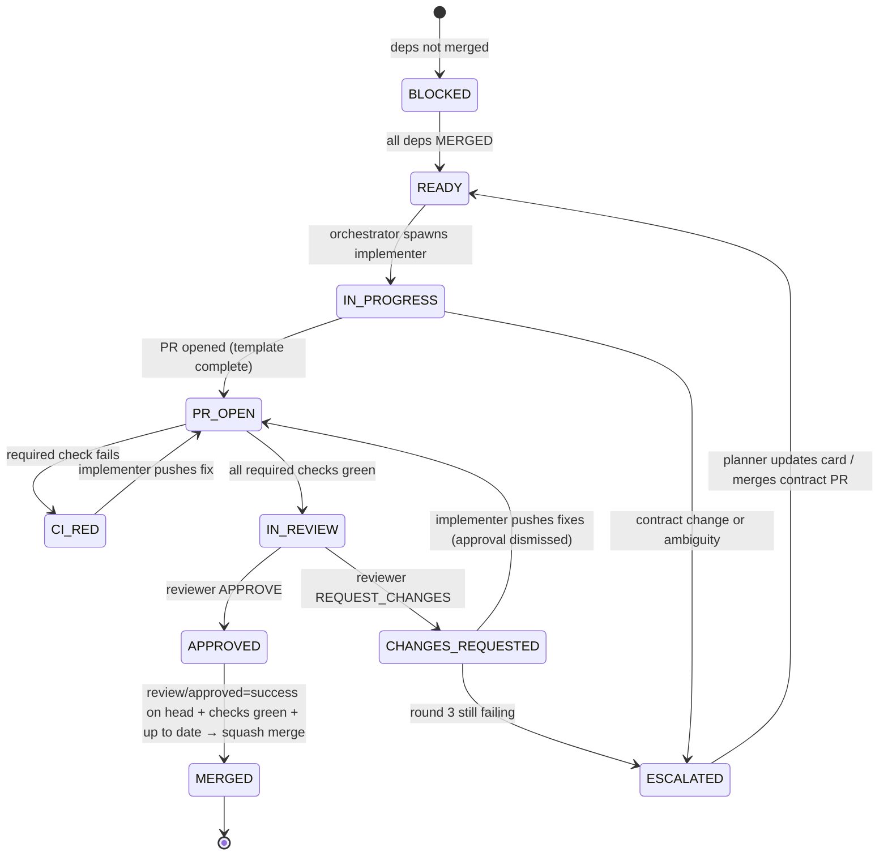

# Desk Brief — Agent Workflow (Planner / Implementer / Reviewer)

Status: v1, 2026-11-15. Applies to every change merged to `main`.

## 1. Roles

| Role | Model | Context | Does | Never does |
|---|---|---|---|---|
| Orchestrator | (your harness) | Task board only | Dispatches cards, spawns agents, tracks state, merges when gates pass | Writes code, approves PRs |
| Planner | `claude-opus-5-5` | Long-lived; spec, plan, board | Owns `docs/plan/*`, writes/splits task cards, approves contract changes, answers escalations, runs phase gates | Writes feature code, reviews its own cards' PRs |
| Implementer | `claude-sonnet-5-5` | Fresh per card (card + spec + repo) | One card → one branch → one PR; TDD; answers review findings | Edits files outside the card's **Owns**, merges, changes contracts |
| Reviewer | `claude-sonnet-5-5` | **Brand-new agent per review round, zero prior context.** Gets only: repo, PR number | Reads PR → card → cited spec sections → diff → runs CI locally → posts review comment → sets `review/approved` status on head SHA | Edits code, pushes commits, merges, sees implementer chat |

Why a fresh reviewer: it judges the PR only by what is written down (card, spec, code, tests). If the reviewer can't understand it from the repo, a human next month can't either — that is a finding.

## 2. Task state machine



Board lives in `docs/plan/STATUS.md` (planner-owned): one row per card with state, branch, PR link, review round, blocker.

## 3. Orchestrator loop

```
loop:
  for card in board where state == READY and lanes_free > 0 and no file-ownership overlap with IN_PROGRESS cards:
      spawn Implementer(card)            # prompt §8.2
  for pr in open PRs:
      if required checks green and state == PR_OPEN:
          spawn NEW Reviewer(pr)         # prompt §8.3, fresh agent every round
      if reviewer verdict == REQUEST_CHANGES:
          send findings to the same Implementer session (or a fresh one with the PR + findings)
      if status review/approved == success on head SHA and all checks green:
          gh pr update-branch <pr>  → wait for checks → gh pr merge <pr> --squash --delete-branch
          mark MERGED; unblock dependents
  if any ESCALATED: route to Planner
```

Merge only when **all** hold: required checks green on the latest commit; commit status `review/approved` = success on the latest commit (set only by a reviewer agent); branch up to date with `main`; no unresolved review threads. Branch protection enforces this; the orchestrator must not be able to bypass it ("Include administrators" on).

Concurrency limits: ≤ 6 implementers at once; never two open PRs owning the same file. If a merge makes another PR conflict, its implementer rebases (never the reviewer).

## 4. Review rounds and escalation

- Max 3 review rounds per PR. Round 3 still REQUEST_CHANGES → ESCALATED to planner, who either splits the card, clarifies it, or rules on the disputed finding (ruling recorded in the PR).
- Implementer disagrees with a finding → replies with reasoning in the thread; the next fresh reviewer decides. Two reviewers in a row upholding it → implementer must comply or escalate.
- Only **blocker** and **major** findings block approval. **minor**/**nit** are listed; the implementer may fix or defer to a follow-up card (planner adds it).

## 5. CI — required checks (all must pass)

| Check name | Command | Fails when |
|---|---|---|
| `lint` | `uv run ruff check . && uv run ruff format --check .` | any lint/format issue |
| `typecheck` | `uv run mypy --strict src` | any type error |
| `test` | `uv run pytest -m "not integration" --cov=src/deskbrief --cov-fail-under=85` with sockets disabled | test failure, coverage < 85%, any test opening a socket |
| `lockfile` | `uv lock --check` | `pyproject.toml` and `uv.lock` out of sync |
| `security` | gitleaks on diff; `pip-audit`/`uv` audit on lock | secret detected; known-vulnerable dep (high) |
| `config` | `uv run python -m deskbrief.config` | `config.yaml` fails schema/cross-reference validation |
| `contracts` | `tests/contract/` + script: if a PR touches contract files (list in implementation plan) it must carry label `contract` and title prefix `contract:` | unlabeled contract change |
| `vba-manifest` (from T33) | `.bas` hashes match `vba/MANIFEST.json` | VBA source changed without rebuilt bin |
| `pr-hygiene` | PR body has all template sections filled, references a card `T\d+`, title is `t<id>: <summary>` or `contract: …` | missing |

`make ci` runs the same commands locally; implementers and reviewers both run it.

## 6. Branch protection on `main` (H3) — single-account design

The project has one human and one GitHub account, and GitHub does not let an account approve its own PR. So approval is expressed as a **required commit status** instead of a GitHub review:

- Reviewer agent posts its full review as a PR comment (`gh pr review --comment` + inline comments).
- Then it sets a commit status on the PR head SHA:
  `gh api -X POST repos/{owner}/{repo}/statuses/{head_sha} -f state=success|failure -f context=review/approved -f description="reviewer round N: APPROVE|REQUEST_CHANGES"`
- Statuses are attached to a SHA, so **any new push makes the approval stale automatically** (the new SHA has no `review/approved` status → merge blocked until a fresh reviewer runs).
- Only reviewer agents may set this status. The implementer and orchestrator prompts forbid it; the orchestrator logs who set every status in `docs/plan/STATUS.md`. This is a process control, not a security boundary — acceptable for a solo project and documented as such.

Settings (Settings → Branches → rule for `main`, or ruleset):
- Require a pull request before merging; required approvals: **0** (the status replaces it).
- Require status checks to pass: all §5 checks **and `review/approved`**; require branches to be up to date.
- Require conversation resolution; require linear history (squash only); block force pushes and deletions; **do not allow bypassing** ("Include administrators" / enforce for admins) so the orchestrator cannot merge around the gate.

## 7. PR template (`.github/pull_request_template.md`)

```markdown
## Card
T__ — <title>  (link to docs/plan/implementation-plan.md#t__)

## What changed
- …

## Spec sections implemented
§…

## Acceptance criteria
- [ ] <copied from card, each ticked with evidence: test name or log excerpt>

## Tests
- New/changed tests: …
- Fault-injection tests (if any): …
- `make ci` output (last lines): …

## Live probe (source cards only)
Endpoint verified on <date>; status; sample rows; any surprises.

## Honesty / labeling
- [ ] No synthetic data outside tests/
- [ ] Proxies, delays, IEX, fallback, HYPOTHETICAL labeled where shown

## Files outside "Owns"
None / <list + planner approval link>

## Risks and follow-ups
…
```

## 8. Prompts

### 8.1 Planner (Opus 5.5) — standing instructions

```
You are the planner for Desk Brief. Sources of truth: docs/specs/2026-11-15-desk-brief-design.md,
docs/plan/implementation-plan.md, docs/process/agent-workflow.md. You own docs/plan/* and
docs/plan/STATUS.md. You do not write feature code.
Responsibilities: keep STATUS.md accurate; mark cards READY when deps are MERGED; answer implementer
escalations by editing the card (never by chat-only answers — the reviewer must be able to see it);
approve or reject contract changes; split cards that exceed ~400 lines; run phase gates G0–G4 and turn
findings into new cards; keep the critical path (T24A first scheduled run, T31 email) protected.
When you change a card, note the change and reason at the bottom of the card ("Changelog").
```

### 8.2 Implementer (Sonnet 5.5) — per card

```
You are implementing card T{ID} in the desk-brief repo.
Read, in order: the card in docs/plan/implementation-plan.md; the spec sections it cites; the
contracts (src/deskbrief/models.py, schemas.py, sources/base.py, store/backend.py, config.py).
Rules:
- Branch t{ID}-{slug} from latest main. Only touch files in the card's "Owns" list plus tests/fixtures.
- TDD: write the failing test, make it pass, refactor. No network in unit tests. Synthetic data only
  under tests/, with a "SYNTHETIC FIXTURE" or "INJECTED FAULT" header.
- If you need to change a contract or a file you don't own, or the card is ambiguous: stop and
  escalate to the planner with a concrete proposal. Do not guess.
- Run `make ci` until green. Keep the PR ≲400 changed lines (excluding fixtures/lockfile).
- Source cards: run one live probe locally with real keys (never commit responses from commercial
  providers) and record results in the PR.
- Open the PR with the template fully filled; title `t{ID}: <summary>`.
- Append an entry to docs/agent-log.md: date, card, what you did, what went wrong, decisions.
- On review: address each finding by number; reply in each thread; push fixes as new commits
  (no force-push). Never resolve a reviewer's thread yourself — the next reviewer does.
- Never set the `review/approved` commit status. Only reviewer agents set it.
```

### 8.3 Reviewer (Sonnet 5.5) — fresh agent every round

```
You are reviewing PR #{N} in desk-brief. You have no other context; that is intentional.
1. Read the PR description. Identify the card T{ID}. Read that card and every spec section it cites,
   plus docs/process/agent-workflow.md §5–7.
2. Check out the PR branch. Run `make ci`. Record the result.
3. Review the diff against this checklist:
   Correctness   - Does it meet every acceptance criterion? Verify each one yourself (run the named test,
                   read the code); don't trust ticked boxes.
                 - Timezones: all stored times UTC-aware; ET only at the edges. Units (pct vs bps vs ratio).
                 - Calendar: weekends/holidays produce skip, not fail.
   Contracts     - No change to contract files unless PR is a labeled contract PR. Schemas validated on write.
   Scope         - Only files in the card's Owns (+tests). No unrelated refactors. No speculative features.
   Failure modes - Source errors isolated; no bare except; errors recorded, not swallowed; write-once raw.
   Tests         - Meaningful assertions, edge cases, fault-injection where the card asks. No network.
                   No synthetic data outside tests/. Tests would fail if the code were wrong.
   Security      - No secrets in code, logs, fixtures, or URLs; redaction used for logged requests.
   Honesty       - Proxy/delay/IEX/fallback/HYPOTHETICAL labels wherever values are shown.
   Clarity       - Could a new engineer understand this module from the repo alone?
4. Post ONE review as a comment: `gh pr review {N} --comment --body-file review.md` (plus inline comments).
   Verdict is APPROVE if no blocker/major findings, else REQUEST_CHANGES.
   Then set the gate on the exact head SHA you reviewed:
     gh api -X POST repos/{owner}/{repo}/statuses/{head_sha} -f state=<success|failure> \
       -f context=review/approved -f description="reviewer round {R}: <VERDICT>"
   Body format:
     VERDICT: APPROVE|REQUEST_CHANGES  (head <sha>)
     CI: pass|fail (summary)
     Acceptance: each criterion → verified / not verified (how)
     Findings:
       1. [blocker|major|minor|nit] path:line — problem — why it matters — suggested fix
   Put line-specific findings as inline comments too.
5. Do not edit code, push, or merge. Do not approve if CI is red.
```

## 9. Agent log format (`docs/agent-log.md`)

```
## 2026-11-17 · T14 Alpaca source · implementer (sonnet-5.5)
- Did: …
- Went wrong: SIP request inside 15-min window returned 403; added window guard + test.
- Decisions: …
- Review rounds: 2 (finding #3 pagination edge case)
```

Real production incidents go to `INCIDENTS.md`, not here. The agent log is how the project was *built*; INCIDENTS is how it *ran*.
