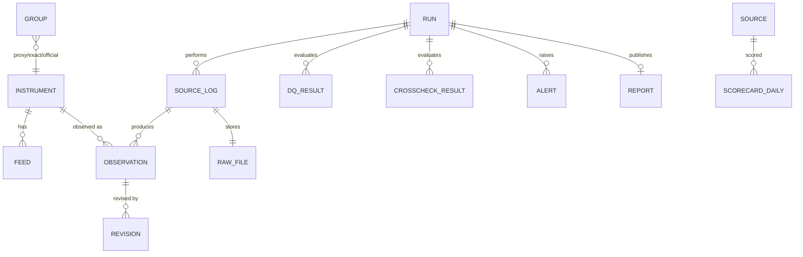

# Desk Brief — System Design Spec

Status: v1, 2026-11-15. Owner: Allen Varghese. Author: planner.
Companion docs: `docs/plan/implementation-plan.md` (phases, task cards), `docs/process/agent-workflow.md` (planner / implementer / reviewer protocol, CI gates).

> Personal project built on public data. Real data only; synthetic data appears only inside tests and is labeled as fault injection or fixtures.

---

## 0. Decisions log (settled)

| # | Decision | Choice | Why |
|---|---|---|---|
| D1 | Persistent storage | Private Cloudflare R2 bucket. Raw files immutable; clean/derived as Parquet; DuckDB is the query engine, not the store | $0, no egress fees, no single-writer lock, reproducible, keeps provider data out of the public repo |
| D2 | Source of truth | `raw/` only. Everything else is rebuildable from raw | Parser bugs and provider revisions become replayable, not fatal |
| D3 | Scheduler | GitHub Actions cron, designed as if unreliable: idempotent runs, catch-up, SLA watchdog, dead-man's-switch | Free, public run history for reviewers; failures become real incidents |
| D4 | Dataframe library | pandas (transforms, Excel); DuckDB SQL for queries/joins over Parquet | Brief standard; team-familiar |
| D5 | Excel | `.xlsx` (pandas + XlsxWriter) **and** `.xlsm` macro workbook (XlsxWriter `add_vba_project`). VBA source in repo as `.bas` | User request |
| D6 | Report delivery | Email (HTML body + `.xlsx`/`.xlsm` attachments). Archived to R2 | User request |
| D7 | Dashboard hosting | Hosted privately (Streamlit Community Cloud private app, allowlisted viewers) showing delayed + official tiers. Live tier-1 polling only in `local` mode | User request + free-tier display terms |
| D8 | Universe | User's revised list (§3) — every instrument has a cross-check partner | Pairing is the core of the project |
| D9 | Cross-checks run in batch | IEX vs SIP compared on the *same minute* retrospectively from historical bars; FX vs ECB from historical 1-min series | No always-on poller needed; only the dashboard needs a live process |
| D10 | Layering | raw (bronze) → clean (silver) → derived (gold) → serving (tiny snapshot files for dashboard) | Fast dashboard, few R2 reads |

### Open decisions (defaults chosen; user can override, nothing is blocked)

| # | Question | Default |
|---|---|---|
| O1 | Reviewer GitHub identity | **Settled: single account.** Reviewer agent posts its review as a PR comment and sets a required commit status `review/approved` on the head SHA (workflow doc §6). A new push changes the SHA, so approval is automatically stale |
| O2 | Email sender | Gmail SMTP + app password (free, can send to any recipient). Use Resend instead if you own a domain |
| O3 | `vbaProject.bin` must be produced once in desktop Excel (Mac or Windows) | Human task H6. Until it exists, `.xlsm` export is skipped with a logged warning, `.xlsx` still ships |

---

## 1. Goals, non-goals, constraints

**Goals:** overnight brief at ~07:00 ET on NYSE business days; near-live dashboard; every number carries source, tier, as-of; cross-source checks; measured per-source scorecard; incident log grounded in real runs.

**Non-goals:** trading, signals, predictions, backtests; public display of live provider data; claims of production use.

**Constraints:** $0/month; free API limits (§5.3); Python 3.12, uv, pandas, DuckDB, pytest, ruff, mypy, Streamlit, XlsxWriter; secrets only in env vars / GitHub secrets / Streamlit secrets.

---

## 2. Architecture

### 2.1 Context / deployment

```mermaid
flowchart LR
  subgraph Providers
    TR[Treasury]:::off; FRED[FRED]:::off; ECB[ECB]:::off; STQ[Stooq]:::off; CBOE[Cboe VIX csv]:::off
    ALP[Alpaca IEX + SIP]:::mkt; TD[Twelve Data]:::mkt; YH[Yahoo / yfinance]:::mkt
  end
  subgraph GHA[GitHub Actions - public repo]
    M[morning.yml 10:15/11:15 UTC]; I[intraday.yml every 15m]; E[eod.yml 22:30 UTC]; S[sla.yml 12:20 UTC]; B[backfill.yml manual]; CI[ci.yml on PR]
  end
  subgraph R2[Cloudflare R2 - private bucket]
    RAW[(raw/)]; CLEAN[(clean/)]; DER[(derived/)]; SERV[(serving/)]; REP[(reports/)]; LOGS[(logs/)]
  end
  Providers --> M & I & E
  M & I & E --> RAW --> CLEAN --> DER --> SERV
  M --> REP --> MAIL[Email recipients]
  S -->|missing report| MAIL
  M & E -.ping.-> HC[healthchecks.io dead-man switch]
  SERV --> DASH[Streamlit Cloud private app]
  CLEAN --> DASH
  SERV --> LOCAL[Local dashboard + live polling]
  classDef off fill:#eef,stroke:#88a; classDef mkt fill:#efe,stroke:#8a8;
```

### 2.2 Layers and the one rule per layer

| Layer | Content | Format | Rule |
|---|---|---|---|
| raw | Exact provider response bytes + `.meta.json` sidecar | json/csv/xml as received | Write-once. Key contains timestamp + sha256 prefix; writer refuses to overwrite |
| clean | Normalized observations, fetch log, quarantined rows | Parquet, one file per run per dataset | Derived from raw only. Every row carries `fetch_id`, `as_of`, `ingested_at`, `parser_version` |
| derived | dq_results, crosscheck_results, revisions, alerts, scorecard, runs | Parquet | Derived from clean only |
| serving | Small snapshot files the dashboard reads every refresh | Parquet / JSON, overwritten per run | Derived from derived+clean; disposable |
| reports | brief.html, brief.xlsx, brief.xlsm per date | files | One folder per report date, versioned `v{n}` on reruns |

### 2.3 Point-in-time (bitemporal) model

Every observation has two times:
- `as_of` — when the market/publisher says the value applies (UTC).
- `ingested_at` — when we fetched it (UTC).

All versions are kept. Views:
- `obs_latest` — latest `ingested_at` per natural key.
- `obs_pit(t)` — latest version with `ingested_at <= t` (table macro). Lets us reproduce exactly what the 07:00 report knew.

A differing value for the same natural key is a **revision**: recorded in `revisions`, raises a `revision` DQ result.

### 2.4 Failure isolation principles

1. One source failing never blocks others. Run status becomes `degraded`, not `failed`.
2. A parse/validation failure quarantines that fetch's rows (`clean/quarantine/`) and emits a DQ `fail`; the run continues.
3. The morning report always ships. Missing inputs appear under "Known limits today".
4. Runs are idempotent: rerunning a job for the same target date creates no duplicate logical rows (views dedupe on natural key).
5. Flush semantics (P-008): the runner buffers clean rows in memory and writes each (table, ET date) once, in a `finally` block, so a failing source never loses other sources' rows. If the process dies before the flush, nothing clean is written for that run, but raw/ already holds every fetched response, so `rebuild` (or the next run's catch-up) recovers it. The `runs` row is written last, so a run that died mid-flush counts as missed and is retried by catch-up. A retried run always gets a new `run_id`, so it can never collide with a half-flushed predecessor; duplicate logical rows are removed by the `obs_latest` view.
6. Catch-up: each scheduled job checks the `runs` table for missed target dates (last 5 business days) and backfills them, marked `trigger=catchup`.

---

## 3. Instrument universe and pairings

Tier legend: **T1** fast/proxy, **T2** exact but delayed, **T3** official daily.

| Group (quantity) | T1 fast proxy | T2 exact delayed | T3 official | Relation used in check |
|---|---|---|---|---|
| sp500 | SPY (Alpaca IEX) | ES=F (Yahoo); SPY (Alpaca SIP, Yahoo) | SPY close (Stooq) | return vs return |
| nasdaq | QQQ (IEX) | QQQ (SIP, Yahoo) | QQQ close (Stooq) | same instrument |
| smallcap | IWM (IEX) | IWM (SIP, Yahoo) | IWM close (Stooq) | same instrument |
| oil_wti | USO (IEX) | CL=F (Yahoo) | DCOILWTICO (FRED) | return vs return; roll days → warn only |
| oil_brent | BNO (IEX) | BZ=F (Yahoo) | DCOILBRENTEU (FRED) | return vs return |
| gold | GLD (IEX) | GC=F (Yahoo) | none (verify; FRED LBMA series discontinued) | return vs return |
| ust_2y | SHY (IEX) | none | DGS2 (FRED), Treasury curve 2Y | inverse-duration |
| ust_10y | IEF (IEX) | ^TNX (Yahoo, ÷10 if needed — verify scale) | DGS10 (FRED), Treasury curve 10Y | inverse-duration; Treasury vs FRED |
| ust_long | TLT (IEX) | none | DGS20, DGS30 (FRED), Treasury curve 20Y/30Y | inverse-duration |
| ust_3m | — | ^IRX (Yahoo) | DTB3? / Treasury curve 3M (verify) | level vs level |
| eurusd, gbpusd, usdjpy | Twelve Data | Yahoo (EURUSD=X etc.) | ECB reference (cross via EUR for GBP, JPY) | level at 14:15 CET |
| vix | — | ^VIX (Yahoo) | Cboe VIX_History.csv (verify access) | level vs level |
| intl indices | — | ^N225, ^FTSE, ^GDAXI (Yahoo) | next-day Yahoo close (self-consistency) | close stability |
| stocks (portfolio only) | AAPL, MSFT, NVDA (IEX) | SIP, Yahoo | Stooq close | same instrument |
| macro | — | — | CPIAUCSL, UNRATE (monthly), DFF (daily) (FRED) | revision + freshness only |

ECB cross rates: ECB publishes EUR base. GBPUSD = EURUSD_ecb / EURGBP_ecb; USDJPY = EURJPY_ecb / EURUSD_ecb. Derived values are tagged `derived=true`.

Durations for inverse-duration checks live in config (approximate effective durations; verify against issuer fact sheets at build time): SHY ~1.9, IEF ~7.0, TLT ~16.5. Expected ETF return ≈ −D × Δyield (in decimal).

---

## 4. Configuration (`config.yaml`) — contract

Validated by pydantic models in `deskbrief/config.py`. Shape:

```yaml
version: 1
timezone_report: America/New_York
storage:
  backend: r2            # r2 | local
  bucket: deskbrief-data
  local_root: ./.data    # used when backend=local (tests, dev)
sources:
  alpaca:     {rate_per_min: 180, timeout_s: 10, retries: 3}
  twelvedata: {rate_per_min: 7, daily_budget: 750, timeout_s: 10, retries: 2}
  fred:       {rate_per_min: 100, timeout_s: 15, retries: 3}
  treasury:   {rate_per_min: 30, timeout_s: 20, retries: 3}
  ecb:        {rate_per_min: 30, timeout_s: 15, retries: 3}
  stooq:      {rate_per_min: 20, timeout_s: 15, retries: 2}
  yahoo:      {rate_per_min: 30, timeout_s: 15, retries: 2}
  cboe:       {rate_per_min: 10, timeout_s: 15, retries: 2}
instruments:
  - id: SPY
    name: SPDR S&P 500 ETF
    asset_class: equity      # equity|rates|fx|commodity|index|vol|macro
    kind: etf                # etf|stock|future|index|yield|fx|macro
    unit: USD                # USD | pct | fx_rate | index_pts  (observations may also use shares for volume)
    feeds:
      - {source: alpaca, dataset: iex_latest, symbol: SPY, tier: 1}
      - {source: alpaca, dataset: sip_bars_1m, symbol: SPY, tier: 2}
      - {source: yahoo, dataset: quote, symbol: SPY, tier: 2}
      - {source: stooq, dataset: daily, symbol: spy.us, tier: 3}
  - id: UST_10Y
    asset_class: rates
    kind: yield
    unit: pct
    feeds:
      - {source: yahoo, dataset: quote, symbol: ^TNX, tier: 2, scale: 0.1}  # verify scale
      - {source: fred, dataset: series, symbol: DGS10, tier: 3}
      - {source: treasury, dataset: par_curve, symbol: "10 Yr", tier: 3}
  # ... full list per §3
groups:
  - id: ust_10y
    label: US 10-year
    proxy: IEF
    exact: UST_10Y
    official: UST_10Y
    relation: inverse_duration   # same | return | inverse_duration | level
    duration: 7.0
    tolerance: {warn_bps: 15, fail_bps: 40}
datasets:                       # expected publish times drive freshness
  - {source: treasury, dataset: par_curve, expected_by_et: "18:00", lag_bdays: 0, calendar: SIFMA_US}
  - {source: fred, dataset: series, expected_by_et: "16:30", lag_bdays: 1, calendar: SIFMA_US}
  - {source: ecb, dataset: eurofxref, expected_by_et: "11:00", lag_bdays: 0, calendar: TARGET}
  - {source: stooq, dataset: daily, expected_by_et: "20:00", lag_bdays: 0, calendar: XNYS}
checks:
  anomaly: {window_days: 30, z_warn: 3.0, z_fail: 5.0}
  validity:                     # sane ranges by unit/kind
    yield_pct: [-2, 25]
    fx: [0.0001, 100000]
    price_usd: [0.01, 1000000]
crosschecks:
  iex_vs_sip:   {symbols: [SPY, QQQ, IWM, GLD, TLT], warn_bps: 5, fail_bps: 20, max_fail_minutes_pct: 5}
  fx_vs_ecb:    {pairs: [EURUSD, GBPUSD, USDJPY], fix_time_cet: "14:15", warn_bps: 5, fail_bps: 15}
  official_pair: {pairs: [[DGS10, "10 Yr"], [DGS2, "2 Yr"], [DGS30, "30 Yr"]], warn_bps: 0.5, fail_bps: 2}
  yahoo_vs_primary: {warn_bps: 10, fail_bps: 50}
  close_vs_official: {warn_bps: 5, fail_bps: 25}
report:
  recipients_env: REPORT_RECIPIENTS   # comma-separated, from secret
  headline_instruments: [ES_F, UST_10Y, EURUSD, WTI, VIX]   # S&P futures trade overnight; SPY does not
dashboard:
  mode_env: DESKBRIEF_DISPLAY_MODE    # hosted | local
  refresh_seconds: 60
  hosted_hidden_tiers: [1]
```

All thresholds above are starting values; tuning them is expected and each tuning is an INCIDENTS.md entry ("false alarm tuned").

---

## 5. Sources and ingestion

### 5.1 Provider interface — contract (frozen after T01)

```python
# deskbrief/sources/base.py
@dataclass(frozen=True)
class FetchRequest:
    source: str
    dataset: str
    params: Mapping[str, str]  # never contains secrets
    symbols: tuple[str, ...]
    target_date: date | None
    window: tuple[datetime, datetime] | None  # UTC


@dataclass(frozen=True)
class RawResponse:
    request: FetchRequest
    fetch_id: str  # ulid
    requested_at: datetime
    responded_at: datetime  # UTC
    http_status: int | None
    content_type: str
    body: bytes
    error: str | None  # set on transport/HTTP failure; body may be empty


class Source(Protocol):
    name: str
    parser_version: str  # bump on any parse change

    def plan(self, job: JobKind, ctx: RunContext) -> list[FetchRequest]: ...
    def fetch(self, req: FetchRequest, http: HttpClient) -> RawResponse: ...  # IO only
    def parse(self, raw: RawResponse) -> pd.DataFrame: ...  # pure; returns OBS_COLUMNS
```

- `fetch` does IO only; `parse` is a pure function of bytes → DataFrame. Parsers are unit-tested from fixture files and can replay any raw file.
- `HttpClient` (shared, `sources/http.py`): httpx, per-source token-bucket rate limiter, retry with exponential backoff + jitter on timeout/5xx/429 (honors `Retry-After`), no retry on 401/403/404, secret redaction of URLs/headers before logging, User-Agent from config (EDGAR later).
- Twelve Data daily budget tracked in `logs/budget/twelvedata/date=…json`; when ≥ budget, requests are skipped with status `budget_exhausted`.
- yfinance is wrapped behind the same interface; its "raw" is the JSON/CSV we serialize from its returned DataFrame plus library version (documented limitation: not byte-exact provider response).

### 5.2 Source catalogue (verify each on day 1 — task T10–T17 acceptance includes a recorded live probe)

| Source | Datasets | Endpoint (verify) | Auth | Notes |
|---|---|---|---|---|
| Treasury | par_curve | home.treasury.gov daily par yield curve CSV/XML for month | none | Published after close; holidays per SIFMA |
| FRED | series | api.stlouisfed.org/fred/series/observations | `FRED_API_KEY` | Request `realtime_start`/`end` to see vintages; values "." mean missing |
| ECB | eurofxref | data-api.ecb.europa.eu SDMX (EXR.D.USD+GBP+JPY.EUR.SP00.A), CSV | none | ~16:00 CET; TARGET holidays |
| Stooq | daily | stooq.com CSV download | none / verify | Verify current access policy; if blocked, mark source disabled and use Yahoo daily close as T3 fallback **labeled as fallback** |
| Cboe | vix_history | cdn.cboe.com VIX_History.csv | none | Verify |
| Alpaca | iex_latest, sip_bars_1m, iex_bars_1m (daily_bars dropped, P-003) | data.alpaca.markets v2 stocks | key id + secret headers | Free: IEX real-time; SIP only ≥15 min old |
| Twelve Data | fx_quote (batch), fx_series_1m | api.twelvedata.com | `apikey` param (redact!) | 8/min, 800/day; batch counts per symbol |
| Yahoo | quote, history | yfinance | none | Unofficial; second opinion only; expect rate limits from GHA IPs |

### 5.3 Request budget per day (weekday)

| Job | Alpaca | Twelve Data | Yahoo | Official |
|---|---|---|---|---|
| morning | ~5 | 3 | ~4 batch | ~12 |
| intraday ×~30 | ~2 each = 60 | 3 each = 90 | 1–2 each, +1 batch at the ECB fix (P-012) | 0 |
| eod | ~25 (bars for 10 syms × 2 feeds) | 3–6 (1-min series for fix window) | ~4 | ~6 |
| dashboard local (8h @ 60s) | ~480 | **0 by default** (reads serving); live FX only if budget left | 0 | 0 |
| **Total** | ≪ 200/min | **~100–200 / 750 budget** | low | low |

### 5.4 Jobs

| Job | Trigger (UTC) | Target | Steps |
|---|---|---|---|
| `morning` | two crons, `15 10 * * 1-5` and `15 11 * * 1-5` (P-013); code proceeds only for the trigger landing 06:00–07:00 ET (handles DST), other one exits as `skipped` | previous NYSE business day close → now | catch-up → fetch official (T3 for D-1) + overnight (Yahoo intl indices, futures, FX, VIX) + Alpaca pre-market latest → clean → checks → alerts → scorecard → build serving → report (html/xlsx/xlsm) → email → write `runs` → ping healthcheck |
| `intraday` | cron `*/15 13-21 * * 1-5`; code exits early outside NYSE session. Plus cron `15 12 * * 1-5` (P-012). At the 14:15 Europe/Berlin ECB fix (12:15 UTC summer, 13:15 UTC winter) the run fetches Yahoo quotes even before the NYSE open; the 12:15 trigger is `skipped` in winter | now | fetch Alpaca IEX latest, Twelve Data FX batch, Yahoo quotes (ES=F, CL=F, BZ=F, GC=F, ^TNX, ^VIX) → clean → freshness/validity/anomaly → scorecard → serving. At the ECB fix outside the session: Yahoo quotes only (`--sources yahoo`) |
| `eod` | cron `30 22 * * 1-5` | today | Alpaca 1-min bars IEX+SIP for xcheck symbols, daily bars; Twelve Data 1-min around ECB fix; Treasury curve; ECB; Stooq; Cboe → clean → all checks + cross-checks → scorecard → compaction (last 7 ET days) → serving → ping |
| `sla` | cron `20 12 * * 1-5` | today | if no report for today's date: email "report missed SLA", fail job (red X = visible incident) |
| `backfill` | `workflow_dispatch(start, end, sources)` | range | official + daily sources for range; `trigger=manual` |
| `rebuild` | `workflow_dispatch(from_date)` | range | re-parse raw → new `clean/v{N+1}/` → recompute derived → atomically flip `clean/_CURRENT` |

Every job ends with the same serving step (P-017). It rescores `scorecard_daily` for the job's target date, overwriting that date's file. In `eod` only, it then compacts `observations` and `quarantine` for today's ET date and the six before it, skipping partitions with fewer than two files. Last, it writes the serving files, anchored on the current ET date rather than the target date, so a backfill of an old date never replaces the latest view. Every intraday poll counts in the scorecard; for other jobs, the latest run of each job per source counts.

DST: cron is UTC. Each job computes ET local time and NYSE calendar in code and decides; report date is always an ET date. All workflows use `concurrency: {group: deskbrief-pipeline, cancel-in-progress: false}` so runs never overlap.

### 5.5 Pipeline runner — sequence (morning)

```mermaid
sequenceDiagram
  participant GHA as GitHub Actions
  participant CLI as deskbrief CLI
  participant R as Runner
  participant S as Source (xN)
  participant ST as Store (R2)
  participant Q as Checks
  participant RP as Report
  GHA->>CLI: deskbrief run morning
  CLI->>R: RunContext(run_id, job, target_date, git_sha, config_hash)
  R->>ST: read runs → missed dates? (catch-up list)
  loop each source, each FetchRequest
    R->>S: fetch(req)
    S-->>R: RawResponse
    R->>ST: put raw (write-once) + meta sidecar
    R->>ST: append source_log row
    R->>S: parse(raw)
    alt schema valid
      R->>R: buffer rows in memory (per table, per ET date)
    else invalid
      R->>R: buffer quarantine row + dq fail
    end
  end
  Note over R,ST: P-008: flush once per (table, ET date) in a finally block, also when the run is degraded
  R->>ST: append clean/observations, quarantine, source_log (one file per table/date)
  R->>Q: run checks(target_date)
  Q->>ST: dq_results, crosscheck_results, revisions, alerts
  R->>ST: write serving snapshot
  R->>RP: build BriefModel(date) → html, xlsx, xlsm
  RP->>ST: reports/date=…/v{n}/
  RP-->>GHA: email sent, step summary
  R->>ST: runs row (status ok|degraded|failed)
  R-->>GHA: ping healthchecks; exit 0 (ok/degraded) or 1 (failed)
```

---

## 6. Storage layout (R2) — contract

```
deskbrief-data/
  raw/source={src}/dataset={ds}/date={YYYY-MM-DD}/{ingested_at:%Y%m%dT%H%M%S%fZ}_{sha256[:12]}.{ext}
  raw/.../{raw key}.meta.json         # raw key + ".meta.json"; fetch_id, run_id, request (redacted), status, latency, sha256, bytes
  clean/_CURRENT                       # text: "v1"
  clean/v1/observations/date={as_of_date}/run={run_id}.parquet
  clean/v1/quarantine/date={…}/run={run_id}.parquet
  logs/source_log/date={…}/run={run_id}.parquet
  logs/budget/{source}/date={…}.json
  derived/dq_results/date={target_date}/run={run_id}.parquet
  derived/crosscheck_results/date={…}/run={run_id}.parquet
  derived/revisions/date={detected_date}/run={run_id}.parquet
  derived/alerts/date={…}/run={run_id}.parquet
  derived/runs/date={…}/run={run_id}.parquet
  derived/scorecard_daily/date={…}.parquet          # overwritten per day
  serving/latest_snapshot.parquet  serving/health.json  serving/scorecard_30d.parquet
  serving/crosschecks_7d.parquet   serving/series_30d.parquet  serving/runs_14d.parquet
  reports/date={YYYY-MM-DD}/v{n}/brief.html|brief.xlsx|brief.xlsm|model.json
```

- **Partition dates and `as_of`:** defined once in `src/deskbrief/store/backend.py` (module docstring). Raw uses the UTC date of `ingested_at`; observations use the ET date of `as_of`; run-scoped tables use `target_date`. `as_of` for `1d` = 00:00 ET on the reference date, for `1mo` = 00:00 ET on the 1st, for `1m` = bar start, for `tick` = the trade/quote instant.
- **Small-files control:** `eod` compacts the day's `clean/.../run=*.parquet` into `run=compacted-{date}.parquet` (dedup on natural key keeping all distinct versions) and deletes the inputs only after a verified row-count match. Raw is never compacted.
- **Local backend** mirrors the same layout under `.data/` for tests and dev.
- **Access:** DuckDB `httpfs` with `CREATE SECRET (TYPE r2, ...)`. Three R2 API tokens: `ci-writer` (GHA, read/write this bucket), `dashboard-reader` (read-only), `admin` (Allen only, never in CI).

---

## 7. Data model

### 7.1 ER diagram



`INSTRUMENT`, `FEED`, `GROUP`, `SOURCE` come from `config.yaml` and are materialized as DuckDB views (`dim_instrument`, `dim_feed`, `dim_group`) at connection time.

### 7.2 Tables (Parquet schemas; enforced by pandera in `deskbrief/schemas.py`)

**observations** (clean) — natural key `(instrument_id, source, dataset, field, interval, as_of)`

| column | type | notes |
|---|---|---|
| instrument_id | VARCHAR | config id |
| source / dataset | VARCHAR | |
| symbol | VARCHAR | provider symbol |
| tier | TINYINT | 1,2,3 |
| field | VARCHAR | open, high, low, close, last, bid, ask, mid, volume, yield, rate |
| interval | VARCHAR | tick, 1m, 1d, 1mo |
| as_of | TIMESTAMP (UTC) | |
| value | DOUBLE | in `unit` |
| unit | VARCHAR | USD, pct, fx_rate, index_pts, shares |
| is_derived | BOOLEAN | e.g. ECB cross rates |
| is_fallback | BOOLEAN | e.g. Yahoo standing in for Stooq |
| fetch_id / run_id | VARCHAR | lineage |
| ingested_at | TIMESTAMP (UTC) | |
| parser_version | VARCHAR | |

**source_log** — one row per fetch attempt

`fetch_id, run_id, source, dataset, symbols, request_redacted, requested_at, responded_at, latency_ms, http_status, status (ok|empty|error|rate_limited|budget_exhausted|skipped_calendar), error, bytes, sha256, raw_key, rows_parsed, rows_quarantined, data_min_as_of, data_max_as_of, attempt`

**dq_results**

`result_id, run_id, check_name, check_type (freshness|completeness|calendar|validity|anomaly|uniqueness|consistency|revision|reconciliation), source, instrument_id, target_date, evaluated_at, status (pass|warn|fail|skip), observed, threshold, details_json`

**crosscheck_results**

`result_id, run_id, check_name, group_id, target_date, at_time, left_instrument, left_source, left_value, right_instrument, right_source, right_value, relation, expected_value, diff_bps, warn_bps, fail_bps, status, details_json` (each row also emits a `consistency` row in dq_results)

**revisions** — `instrument_id, source, dataset, field, interval, as_of, old_value, new_value, old_fetch_id, new_fetch_id, detected_at, run_id`

**alerts** — `alert_id, run_id, kind (zscore_move|volume_spike|crosscheck_fail|source_down|sla_miss|stale), severity (info|warn|crit), instrument_id, source, as_of, observed, threshold, message`

**runs** — `run_id, job, trigger (schedule|manual|catchup), target_date, scheduled_for, started_at, finished_at, status (ok|degraded|failed), git_sha, config_hash, n_fetch, n_fetch_failed, n_obs, n_dq_fail, n_dq_warn, report_key, schedule_delay_s`

**scorecard_daily** — `source, date, fetches, ok_rate, median_latency_ms, p95_latency_ms, median_data_age_s, error_rate, disagreement_rate, n_crosschecks`

**reports** (in runs + `model.json`) — `report_date, version, run_id, html_key, xlsx_key, xlsm_key, email_status, recipients_count, sent_at`

**holdings / positions** (P4) — `holdings.csv: account, instrument_id, quantity, cost_basis, currency` (HYPOTHETICAL); `broker_statement.csv` same shape; `positions_valued: date, instrument_id, quantity, price, price_source, price_tier, market_value, day_pnl`.

### 7.3 DuckDB views (created by `store/duck.py` on connect)

`obs_all`, `obs_latest`, `obs_pit(t)` (macro), `daily_close` (one end-of-day value per instrument/ET date, fields `close`, `yield` or `rate`, preferring tier 3 → 2 → 1, with `chosen_source` and `field`; latest-version, not point-in-time; consumers label by field/unit per P-009), `overnight_change(date)` (macro), `source_log`, `dq`, `xchecks`, `runs`, `scorecard`, `dim_instrument`, `dim_feed`, `dim_group`.

### 7.4 Core classes (UML)

```mermaid
classDiagram
  class Config { +instruments +groups +sources +datasets +checks +crosschecks +load(path) Config }
  class RunContext { +run_id +job +trigger +target_date +now_utc +git_sha +config_hash +store +config }
  class Source { <<protocol>> +name +parser_version +plan(job, ctx) list~FetchRequest~ +fetch(req, http) RawResponse +parse(raw) DataFrame }
  class HttpClient { +get(url, params, headers) +rate_limiter +retry_policy +redact() }
  class StorageBackend { <<protocol>> +put_bytes(key, data, overwrite=False) +get_bytes(key) +list(prefix) +exists(key) +delete(key) }
  class LocalBackend
  class R2Backend
  class Store { +write_raw(raw) key +append(dataset, df, ctx) +read(dataset, filters) +duck() Connection }
  class Runner { +run(job) RunResult -fetch_all() -clean() -check() -publish() }
  class Check { <<protocol>> +name +check_type +evaluate(ctx, duck) list~DQResult~ }
  class CrossCheck { <<protocol>> +name +evaluate(ctx, duck) list~XResult~ }
  class BriefModel { +date +headline +sections +health +limits +from_store(duck, date) }
  class HtmlRenderer; class ExcelWriter; class VbaWorkbookWriter
  class Notifier { <<protocol>> +send(subject, html, attachments) }
  StorageBackend <|.. LocalBackend
  StorageBackend <|.. R2Backend
  Store o-- StorageBackend
  Runner o-- Source
  Runner o-- Store
  Runner o-- Check
  Runner o-- CrossCheck
  Source ..> HttpClient
  BriefModel ..> Store
  HtmlRenderer ..> BriefModel
  ExcelWriter ..> BriefModel
  VbaWorkbookWriter --|> ExcelWriter
```

---

## 8. Quality checks and cross-checks

### 8.1 Single-source checks (8 types for DoD; reconciliation is the 9th, P4)

| Type | Rule | Status logic |
|---|---|---|
| freshness | data age vs `expected_by_et` + `lag_bdays` per dataset; intraday: age of latest tick vs session. Before `expected_by_et` the check returns `skip` ("not yet due") — e.g. eod at 17:30 ET runs before Treasury/Stooq publish; next morning's run evaluates them | warn > grace, fail > 2×grace; on a SIFMA recommended early close a late `SIFMA_US` value is at most warn (P-011) |
| completeness | every expected (instrument, feed) for target date has ≥1 obs; minute bars ≥ 95% of session minutes (an early-close day counts only minutes up to the early close, P-011) | warn <100%, fail <95% / missing; on a SIFMA recommended early close a missing `SIFMA_US` value is at most warn (P-011) |
| calendar | expected dates come from calendars (XNYS, SIFMA_US, TARGET); holidays/weekends produce `skip`, not fail | — |
| validity | value within range for unit/kind; no NaN/inf; high ≥ low; volume ≥ 0 | fail |
| uniqueness | no duplicate natural key within a single fetch | fail |
| anomaly | |return| or |Δbps| z-score vs 30-day window | warn ≥3, fail ≥5 (fail = "verify", not "wrong") |
| consistency | cross-checks §8.2 | per check |
| revision | same key, new value | warn (macro revisions are normal; recorded) |
| reconciliation (P4) | holdings vs broker statement: quantity and market value | fail on mismatch |

### 8.2 Cross-checks

| Check | Computation |
|---|---|
| iex_vs_sip | For each config symbol and each session minute, compare IEX 1m close vs SIP 1m close (both fetched in `eod`). Report median abs gap (bps), p95, % minutes over warn. Status from `max_fail_minutes_pct`. |
| proxy_vs_exact (return) | Daily return of proxy vs exact (USO vs CL=F, BNO vs BZ=F, GLD vs GC=F, SPY vs ES=F). Fail if direction disagrees and both moves > 25 bps; warn/fail on |diff| thresholds. Futures roll windows → cap at warn. |
| proxy_vs_exact (inverse_duration) | Expected ETF return = −D × Δy. Compare to actual ETF return (SHY↔DGS2, IEF↔DGS10/^TNX, TLT↔DGS20). |
| fx_vs_ecb | Twelve Data 1m mid at 14:15 CET vs ECB reference (cross rates derived). Also Yahoo vs ECB. |
| official_pair | Treasury curve vs FRED DGS* for same date. Expected ≈ exact (FRED republishes Treasury) → this check measures publication lag and revisions; documented honestly. |
| yahoo_vs_primary | Yahoo last vs Alpaca SIP (same minute ±1) for equities; Yahoo FX vs Twelve Data. |
| close_vs_official | Alpaca SIP last 1m bar ending 16:00 ET vs Stooq daily close (closing auction vs last trade → small gaps expected). |

---

## 9. Morning report

**BriefModel** (pure, `report/model.py`) built from DuckDB for an ET report date: overnight changes since previous NYSE close; headline line; sections by asset class; alerts; data-health summary; known limits; lineage table. Serialized to `model.json` → renderers are dumb.

### 9.1 Email / HTML layout (email-safe, inline CSS, single column, ~640px)

```
Desk Brief — Tue 18 Nov 2026, 07:00 ET                       ● 46/48 checks pass
Overnight: S&P fut −0.4% · 10Y 4.31% (−3bp) · EURUSD 1.0842 (+0.2%) · WTI $71.20 (−1.1%) · VIX 16.8

RATES          last     chg      as of (ET)  tier
 US 2Y         4.18%   −2bp     17 Nov       ○ official
 US 10Y        4.31%   −3bp     06:58        ◐ delayed  (^TNX)
 2s10s         +13bp   −1bp
FX / COMMODITIES / EQUITIES / GLOBAL  … same table shape

NOTABLE   • WTI −1.1% is 2.4σ vs 30d  • IEX vs SIP: SPY median gap 0.6bp (pass)
DATA HEALTH  2 warnings: Stooq late (expected 20:00, arrived 21:14) · ^TNX stale 32m
KNOWN LIMITS TODAY  Proxies: USO/BNO/GLD/SHY/IEF/TLT · IEX = one exchange · Brent official lags 1 day
Personal project built on public data. Not investment advice.
```

Tier glyphs everywhere: ● live/proxy (T1), ◐ delayed (T2), ○ official (T3). Proxies always labeled "proxy".

### 9.2 Excel workbook (`.xlsx` and `.xlsm` share one writer)

Sheets: `Brief` (headline + index), `Rates`, `FX`, `Commodities`, `Equities`, `Global`, `Checks`, `Sources`, `Lineage`, `About` (honesty labels, tier legend, limits). Each data block is an Excel Table with a stable name (`tbl_rates`, `tbl_fx`, `tbl_commod`, `tbl_equity`, `tbl_global`, `tbl_checks`, `tbl_sources`, `tbl_lineage`) and stable column headers — **this naming is the contract between Python and VBA.** Number formats: yields `0.00"%"`, bps `+0;-0`, prices `#,##0.00`, FX `0.0000`.

Column headers (P-015; changing them needs a `contract:` PR):

| Table | Headers, in order |
|---|---|
| `tbl_rates`, `tbl_fx`, `tbl_commod`, `tbl_equity`, `tbl_global` | `instrument_id`, `asset_class`, `name`, `label`, `field`, `value`, `unit`, `change`, `change_unit`, `basis`, `status`, `as_of`, `tier`, `tier_name`, `proxy`, `qualifiers`, `description`, `dq_flag`, `as_of_utc` |
| `tbl_checks` | `label`, `kind`, `status`, `check_type`, `source`, `instrument_id`, `group_id`, `observed`, `threshold`, `ref_date` |
| `tbl_sources` | `label`, `status`, `n_fetches`, `n_failed` |
| `tbl_lineage` | `label`, `field`, `role`, `instrument_id`, `value`, `unit`, `as_of_et`, `source`, `dataset`, `symbol`, `tier`, `is_fallback`, `fetch_id`, `run_id`, `requested_at_et`, `latency_ms`, `http_status`, `fetch_status`, `raw_key`, `rows_parsed` |

In the market tables, `status` is the row's own state (for example no baseline). `dq_flag` carries the instrument's worst check result for the report date, for `ShowFlaggedOnly`; `as_of_utc` is a UTC timestamp next to the display text in `as_of`. A table with nothing to list keeps one placeholder row: its first cell reads `none: nothing to list` and the other cells are blank, except that in every table with a `status` column the placeholder's `status` is `empty` (P-016). Macros skip rows whose `status` is `empty`. `tbl_lineage` has no `status` column; macros recognise its placeholder by the first cell. `Volatility` and `Macro` rows sit in `tbl_global`, told apart by `asset_class`.

### 9.3 VBA (`vba/*.bas`, embedded via `vbaProject.bin`)

| Module | Macro | What it does |
|---|---|---|
| modNav | `GoToIndex`, `BuildIndex` | Hyperlinked index on `Brief` |
| modFilter | `ShowFlaggedOnly`, `ShowAll`, `ToggleProxies` | Filter all tables to rows with warn/fail, or hide proxy rows |
| modFormat | `ApplyHighlights` | Re-apply breach highlighting after user edits |
| modCharts | `RebuildCharts` | 30-day sparkline-style charts from `tbl_*` |
| modExport | `ExportBriefPDF` | One-page PDF of `Brief` |

Build: H6 imports `.bas` files into a blank `.xlsm` in desktop Excel, adds buttons on `Brief`, saves; `uv run vba_extract.py` (ships with XlsxWriter) produces `vba/vbaProject.bin`; `vba/MANIFEST.json` records sha256 of each `.bas` used. CI fails if a `.bas` changed without a new `vbaProject.bin` + manifest. Known limit: Office blocks macros in files from the internet (Mark of the Web) — README documents "Unblock" steps; `.xlsx` is the default attachment, `.xlsm` is optional.

---

## 10. Dashboard

### 10.1 Modes

| Mode | Where | Reads | Live polling | Tiers shown |
|---|---|---|---|---|
| hosted | Streamlit Community Cloud, private app, viewer allowlist (owner + invited reviewers) | `serving/*` (cached 60s), `clean` for drill-down | none | 2, 3 (+ T1 snapshots ≥15 min old only if terms allow — verify, default hidden) |
| local | `uv run streamlit run app/Home.py` | same + direct provider calls | every 60s, budget-aware | 1, 2, 3 |

Dashboard never writes to R2. It uses the read-only token.

### 10.2 Design principles (minimalist, insight-first)

- One accent color for state only: neutral text, muted green/red for direction, **red reserved for check failures**. No gradients, no shadows, no card borders where whitespace works.
- Tabular figures, right-aligned numbers; units always shown; as-of in ET, relative age on hover ("4m ago").
- Every number has a tier glyph (● ◐ ○); proxies italic + "proxy" label.
- Nothing flashes. Stale data turns grey with "stale" tag, not red.
- Progressive disclosure: overview → row click → provenance drawer.
- Implementers must follow the `dataviz` skill guidance for charts and `taste-skill:minimalist-ui` for layout.

### 10.3 Pages

1. **Overview** (home)
   ```
   Desk Brief                     Tue 18 Nov · 10:42 ET   ● Healthy (46/48)   hosted · delayed+official
   ─────────────────────────────────────────────────────────────────────────────
   S&P fut  6,012  −0.4%   10Y 4.31% −3bp   EURUSD 1.0842 +0.2%   WTI 71.20 −1.1%   VIX 16.8 +0.6
   (each: tiny 1-day sparkline, tier glyph)
   ─────────────────────────────────────────────────────────────────────────────
   RATES                                          │  Yield curve  (today · 1w · 1m)
   instrument   last    chg   30d z  tier  as of  │   ╭───────────
   2Y           4.18%   −2bp   −0.8   ○    17 Nov │  ╱
   10Y          4.31%   −3bp   −1.1   ◐    10:27  │
   …                                              │
   FX · COMMODITIES · EQUITIES · GLOBAL (same table, collapsible)
   ```
2. **Instrument** (drill-down / provenance drawer): three-tier ladder — proxy value, delayed value, official value side by side with gaps vs tolerance; 30-day chart with all tiers overlaid; lineage: source, fetch time, latency, raw key + sha256, parser version; check history for this instrument.
3. **Cross-checks**: one row per check × group, last 7 days as a compact status strip (pass/warn/fail squares), click → gap chart vs tolerance band.
4. **Data health**: today's DQ results grouped by type; freshness timeline per dataset (expected vs actual arrival); revisions log; quarantine list.
5. **Sources (scorecard)**: per source: uptime, median & p95 latency, median data age, error rate, disagreement rate; 30-day trend. Measured numbers only, with "n days of data" shown.
6. **Runs**: last 14 days of runs (job, scheduled vs actual start delay, status, counts), links to GitHub run; incidents list rendered from INCIDENTS.md.

---

## 11. Security and secrets

| Secret | Where |
|---|---|
| ALPACA_KEY_ID, ALPACA_SECRET_KEY, TWELVEDATA_API_KEY, FRED_API_KEY | GHA secrets; local `.env` (gitignored); Streamlit secrets only if local-mode features used there (they aren't) |
| R2_ACCOUNT_ID, R2_ACCESS_KEY_ID, R2_SECRET_ACCESS_KEY | GHA (`ci-writer`), Streamlit (`dashboard-reader`) |
| SMTP_USER, SMTP_APP_PASSWORD, REPORT_RECIPIENTS | GHA |
| HEALTHCHECK_URL_MORNING, HEALTHCHECK_URL_EOD | GHA |

Controls: logging redaction filter for `apikey|api_key|token|secret|password` in URLs, params, headers; `gitleaks` in CI; `pytest-socket` blocks network in unit tests; workflow permissions `contents: read` by default; pinned action SHAs; Dependabot for actions and uv.

---

## 12. Observability

- `structlog` JSON logs with `run_id`, `job`, `source`, `fetch_id`. GHA step summary renders a run table (fetches, failures, checks, report link).
- `runs` table + healthchecks.io (dead-man's switch: alerts if morning/eod don't ping on schedule) + `sla.yml`.
- Every real incident → `INCIDENTS.md` entry: date, what happened, detection (which check/alert), impact, fix, follow-up. Injected faults never appear there.

---

## 13. Testing strategy

| Layer | Tests |
|---|---|
| Parsers | Fixture → DataFrame golden tests per source. Official sources: small real captured files (public domain). Commercial providers: schema-faithful synthetic fixtures in `tests/fixtures/synthetic/`, header comment "SYNTHETIC FIXTURE" |
| HttpClient | retry/backoff/429/Retry-After/redaction with `respx` mocks |
| Store | LocalBackend round-trips; write-once enforcement; views; `obs_pit` correctness |
| Checks / cross-checks | Table-driven tests on synthetic clean frames |
| Fault injection (`tests/fault_injection/`, all files prefixed `inj_`) | late file, duplicate rows, truncated CSV, corrupted JSON, stale prices, NaN, unit flip (^TNX ×10), provider 500/429 storm, budget exhaustion — each asserts the run is `degraded` not crashed and the right DQ fail appears |
| Report | BriefModel from fixture store → snapshot HTML; Excel table names/headers contract test (the VBA contract) |
| Dashboard | Query layer unit tests; `streamlit.testing.v1.AppTest` smoke test per page |
| Integration (`-m integration`, not in PR CI) | Live probe per source; nightly workflow optional |

Coverage gate: ≥85% lines on `src/deskbrief` (excluding `cli.py`).

---

## 14. Repository layout

```
desk-brief/
  pyproject.toml  uv.lock  config.yaml  holdings.csv  broker_statement.csv
  README.md  INCIDENTS.md  Makefile  .env.example  .gitleaks.toml
  src/deskbrief/
    __init__.py  cli.py  config.py  models.py  schemas.py  logging.py  timeutil.py  calendars.py  ids.py
    sources/  base.py http.py registry.py treasury.py fred.py ecb.py stooq.py cboe.py alpaca.py twelvedata.py yahoo.py
    store/    backend.py local.py r2.py raw.py datasets.py duck.py compaction.py
    pipeline/ runner.py jobs.py clean.py catchup.py manifest.py serving.py
    checks/   base.py freshness.py completeness.py calendar_check.py validity.py uniqueness.py anomaly.py revision.py
    crosschecks/ base.py iex_sip.py proxy_exact.py fx_ecb.py official_pair.py yahoo_primary.py close_official.py
    scorecard.py  alerts.py  portfolio.py  query.py
    report/   model.py html.py excel.py vba.py notify.py templates/brief.html.j2
  app/  Home.py  pages/{1_Instrument.py,2_Cross_checks.py,3_Data_health.py,4_Sources.py,5_Runs.py}  components/  theme.py
  vba/  modNav.bas modFilter.bas modFormat.bas modCharts.bas modExport.bas  vbaProject.bin  MANIFEST.json
  tests/ unit/ fault_injection/ contract/ fixtures/{real,synthetic}/ integration/ conftest.py
  .github/ workflows/{ci.yml,morning.yml,intraday.yml,eod.yml,sla.yml,backfill.yml,rebuild.yml}  pull_request_template.md  dependabot.yml
  docs/ architecture.md glossary.md agent-log.md (T00–T05 history) agent-log/T{id}.md (P-014) specs/ plan/ process/ tasks/
```

---

## 15. Honesty rules (enforced in review)

Labels everywhere they appear: proxy, delayed (and by how much), IEX single-exchange, fallback source, HYPOTHETICAL portfolio, derived cross rate. README uses only measured numbers (days run, sources, checks, real incidents, tuned false alarms).
